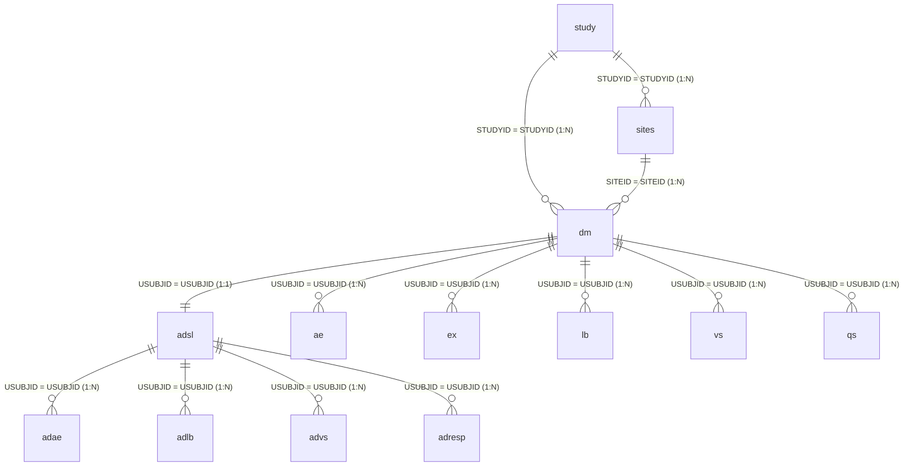

# Clinical Analytics Report Agent (Clinical Analytics Platform)
## Complete End-to-End Technical Audit & Architectural Reference Manual

**Platform Name:** Clinical Analytics Report Agent (Clinical Analytics MVP / AI-Powered Healthcare Analytics & Reporting Platform)  
**Repository:** `Clinical-Analytics-Report-Agent`  
**Development Branch:** `clinical-trial-dataset-migration`  
**Document Classification:** Primary Technical Architecture, Implementation Audit, and Developer Reference  
**Scope:** Full-Stack Audit (React/Vite Frontend, FastAPI/Python Backend, MySQL Clinical Data Layer, LangGraph Agent Workflow, RAG Vector Retrieval, Gemini LLM Orchestration, and ReportLab PDF Publication Engine)

---

## 📑 Clickable Table of Contents

- [Chapter 1: Executive Overview & Business Purpose](#chapter-1-executive-overview--business-purpose)
  - [1.1 Problem Statement & Traditional Bottlenecks](#11-problem-statement--traditional-bottlenecks)
  - [1.2 Proposed AI-Driven Solution](#12-proposed-ai-driven-solution)
  - [1.3 Target Audience & User Personas](#13-target-audience--user-personas)
  - [1.4 Primary Clinical & Operational Use Cases](#14-primary-clinical--operational-use-cases)
  - [1.5 Scope, Boundaries, and Regulatory Constraints](#15-scope-boundaries-and-regulatory-constraints)
  - [1.6 Multi-Perspective Architectural Explanation](#16-multi-perspective-architectural-explanation)
  - [1.7 Implementation Audit vs Legacy Documentation Discrepancies](#17-implementation-audit-vs-legacy-documentation-discrepancies)
- [Chapter 2: High-Level System Architecture & System Topology](#chapter-2-high-level-system-architecture--system-topology)
  - [2.1 End-to-End Architecture Overview](#21-end-to-end-architecture-overview)
  - [2.2 Dual-Workspace Paradigm (Clinical vs Technical)](#22-dual-workspace-paradigm-clinical-vs-technical)
  - [2.3 Core System Invariants & Safety Guardrails](#23-core-system-invariants--safety-guardrails)
- [Chapter 3: Complete Technology Stack Inventory](#chapter-3-complete-technology-stack-inventory)
  - [3.1 Master Inventory Table](#31-master-inventory-table)
  - [3.2 Runtime Status Classification (Installed vs Imported vs Configured vs Active)](#32-runtime-status-classification)
- [Chapter 4: Repository & File Structure Directory Guide](#chapter-4-repository--file-structure-directory-guide)
  - [4.1 Verified Directory Tree](#41-verified-directory-tree)
  - [4.2 Module-by-Module File Directory Reference](#42-module-by-module-file-directory-reference)
  - [4.3 Scripts & Database Utility Inventory](#43-scripts--database-utility-inventory)
- [Chapter 5: Frontend Architecture & UI Component Hierarchy](#chapter-5-frontend-architecture--ui-component-hierarchy)
  - [5.1 Initialization & App Bootstrapping](#51-initialization--app-bootstrapping)
  - [5.2 State Management & Workspace Routing](#52-state-management--workspace-routing)
  - [5.3 WorkspaceSelection View](#53-workspaceselection-view)
  - [5.4 ClinicalDashboard View & All 12 Clinical Subcomponents](#54-clinicaldashboard-view--all-12-clinical-subcomponents)
  - [5.5 TechnicalDashboard View & All 9 Technical Subcomponents](#55-technicaldashboard-view--all-9-technical-subcomponents)
  - [5.6 Interactive Charting & Type Switching Engine (7 Supported Types)](#56-interactive-charting--type-switching-engine)
  - [5.7 Dataset Upload Modal & Ingestion UX](#57-dataset-upload-modal--ingestion-ux)
  - [5.8 Publication PDF Viewer Modal & Canvas Engine](#58-publication-pdf-viewer-modal--canvas-engine)
  - [5.9 Frontend API Client & Network Interceptors](#59-frontend-api-client--network-interceptors)
- [Chapter 6: Backend Architecture & FastAPI Service Layer](#chapter-6-backend-architecture--fastapi-service-layer)
  - [6.1 Application Entry Point & Lifespan Management](#61-application-entry-point--lifespan-management)
  - [6.2 Middleware Configuration & CORS Policy](#62-middleware-configuration--cors-policy)
  - [6.3 Service Layer Decomposition](#63-service-layer-decomposition)
  - [6.4 Pydantic Schemas & DTO Validation](#64-pydantic-schemas--dto-validation)
- [Chapter 7: Comprehensive REST API Reference & Endpoints](#chapter-7-comprehensive-rest-api-reference--endpoints)
  - [7.1 Health & Liveness Endpoints](#71-health--liveness-endpoints)
  - [7.2 Ingestion & Dataset Upload Endpoints](#72-ingestion--dataset-upload-endpoints)
  - [7.3 Relational Review & Candidate Endpoints (Including Regeneration)](#73-relational-review--candidate-endpoints)
  - [7.4 Database Metadata & Table Registry Endpoints](#74-database-metadata--table-registry-endpoints)
  - [7.5 Clinical Analytics & Execution Endpoints](#75-clinical-analytics--execution-endpoints)
  - [7.6 PDF Report Compilation & Certification Endpoints](#76-pdf-report-compilation--certification-endpoints)
- [Chapter 8: MySQL Database Architecture & Clinical Data Model](#chapter-8-mysql-database-architecture--clinical-data-model)
  - [8.1 Database Engine, Connection Pooling & Session Management](#81-database-engine-connection-pooling--session-management)
  - [8.2 Five Infrastructure Metadata Tables](#82-five-infrastructure-metadata-tables)
  - [8.3 The 13 Core Approved Clinical Catalog Datasets](#83-the-13-core-approved-clinical-catalog-datasets)
  - [8.4 Custom & Pending Datasets Policy](#84-custom--pending-datasets-policy)
  - [8.5 Physical Tables vs Registered vs Approved vs User-Selected Datasets](#85-physical-tables-vs-registered-vs-approved-vs-user-selected-datasets)
  - [8.6 Verified Relational Schema & Foreign Key Map](#86-verified-relational-schema--foreign-key-map)
- [Chapter 9: Dataset Ingestion, Schema Inference & Duplicate-Protection Pipeline](#chapter-9-dataset-ingestion-schema-inference--duplicate-protection-pipeline)
  - [9.1 File Upload & Security Validation](#91-file-upload--security-validation)
  - [9.2 Pandas/OpenPyXL Parsing & Header Normalization](#92-pandasopenpyxl-parsing--header-normalization)
  - [9.3 Schema & Semantic Data-Type Inference](#93-schema--semantic-data-type-inference)
  - [9.4 Target Table Resolution (Auto-Match vs New vs Existing)](#94-target-table-resolution)
  - [9.5 Primary Key Discovery & Duplicate Detection Engine](#95-primary-key-discovery--duplicate-detection-engine)
  - [9.6 Atomic Insert-Only-New Mode & Conflict Handling (HTTP 409)](#96-atomic-insert-only-new-mode--conflict-handling)
  - [9.7 Post-Ingestion Audit Logging](#97-post-ingestion-audit-logging)
- [Chapter 10: Natural Language to SQL Pipeline](#chapter-10-natural-language-to-sql-pipeline)
  - [10.1 Intent Recognition & Clinical Question Parsing](#101-intent-recognition--clinical-question-parsing)
  - [10.2 Table Selection & Scope Authorization Check](#102-table-selection--scope-authorization-check)
  - [10.3 Schema Context Construction](#103-schema-context-construction)
  - [10.4 Clinical Question Plan Formulation](#104-clinical-question-plan-formulation)
  - [10.5 SQL Generation via Gemini LLM](#105-sql-generation-via-gemini-llm)
  - [10.6 Plan-to-SQL Coherence Checking & Deterministic Fallbacks](#106-plan-to-sql-coherence-checking--deterministic-fallbacks)
- [Chapter 11: SQL AST Parsing, Safety Controls & Boundary Enforcement](#chapter-11-sql-ast-parsing-safety-controls--boundary-enforcement)
  - [11.1 Forbidden Keyword Blocking & Statement Sanitization](#111-forbidden-keyword-blocking--statement-sanitization)
  - [11.2 AST Table Extraction (Excluding CTEs)](#112-ast-table-extraction)
  - [11.3 Table Authorization & User Selection Enforcement](#113-table-authorization--user-selection-enforcement)
  - [11.4 Qualified and Unqualified Column Authorization](#114-qualified-and-unqualified-column-authorization)
  - [11.5 Approved Relationship Verification (The USUBJID vs STUDYID Rule)](#115-approved-relationship-verification)
  - [11.6 Disconnected Graph Detection](#116-disconnected-graph-detection)
  - [11.7 Safe Read-Only Execution Engine](#117-safe-read-only-execution-engine)
- [Chapter 12: LangGraph Workflow Orchestration & State Transition Graph](#chapter-12-langgraph-workflow-orchestration--state-transition-graph)
  - [12.1 State Definition (`ClinicalAnalyticsState`)](#121-state-definition)
  - [12.2 Graph Nodes Reference (14 Processing Units)](#122-graph-nodes-reference)
  - [12.3 Conditional Routers & Edge Traversal](#123-conditional-routers--edge-traversal)
  - [12.4 Human-in-the-Loop (HITL) Checkpoint Workflow](#124-human-in-the-loop-hitl-checkpoint-workflow)
  - [12.5 Plan Regeneration Loop](#125-plan-regeneration-loop)
  - [12.6 Insight Validation & Auto-Regeneration Loop](#126-insight-validation--auto-regeneration-loop)
- [Chapter 13: Retrieval-Augmented Generation (RAG) Architecture & Vector Store](#chapter-13-retrieval-augmented-generation-rag-architecture--vector-store)
  - [13.1 Knowledge Corpus & Document Sources](#131-knowledge-corpus--document-sources)
  - [13.2 Document Chunking Strategy & Metadata Annotation](#132-document-chunking-strategy--metadata-annotation)
  - [13.3 Sentence-Transformers Embedding Model (`all-MiniLM-L6-v2`)](#133-sentence-transformers-embedding-model)
  - [13.4 FAISS Vector Index Structure (`IndexFlatL2`)](#134-faiss-vector-index-structure)
  - [13.5 Query Construction & Multi-Level Enrichment](#135-query-construction--multi-level-enrichment)
  - [13.6 Context Retrieval, Formatting & Injection](#136-context-retrieval-formatting--injection)
- [Chapter 14: LLM Integration, Gemini Fallback Matrix & Prompt Engineering](#chapter-14-llm-integration-gemini-fallback-matrix--prompt-engineering)
  - [14.1 Google GenAI SDK Client Setup](#141-google-genai-sdk-client-setup)
  - [14.2 High-Throughput Model Cascading Matrix](#142-high-throughput-model-cascading-matrix)
  - [14.3 Rate-Limit (429) & Server Error (503) Recovery](#143-rate-limit-429--server-error-503-recovery)
  - [14.4 Systematic Inventory of System Prompts](#144-systematic-inventory-of-system-prompts)
  - [14.5 Deterministic Fallback Mechanisms](#145-deterministic-fallback-mechanisms)
- [Chapter 15: Analytics Engine, Clinical KPI Calculations & Plotly Visualizations](#chapter-15-analytics-engine-clinical-kpi-calculations--plotly-visualizations)
  - [15.1 Clinical Metrics Definitions (Adverse Event Rates, Response Rates, Lab Changes)](#151-clinical-metrics-definitions)
  - [15.2 Insight Evidence Construction](#152-insight-evidence-construction)
  - [15.3 Plotly Specification Generation](#153-plotly-specification-generation)
  - [15.4 Follow-Up Query Processing](#154-follow-up-query-processing)
  - [15.5 Custom Dashboard Multi-Table Aggregation Engine](#155-custom-dashboard-multi-table-aggregation-engine)
- [Chapter 16: Publication-Grade Clinical Audit PDF Report Generation](#chapter-16-publication-grade-clinical-audit-pdf-report-generation)
  - [16.1 ReportLab Platypus Architecture](#161-reportlab-platypus-architecture)
  - [16.2 Two-Pass `NumberedCanvas` Page Numbering](#162-two-pass-numberedcanvas-page-numbering)
  - [16.3 Matplotlib Headless Chart Compilation](#163-matplotlib-headless-chart-compilation)
  - [16.4 Complete 16-Section Report Layout](#164-complete-16-section-report-layout)
  - [16.5 Regulatory Audit Certification & Download Flow](#165-regulatory-audit-certification--download-flow)
- [Chapter 17: Comprehensive Function, Class & Method Code Reference](#chapter-17-comprehensive-function-class--method-code-reference)
  - [17.1 Backend API Layer](#171-backend-api-layer)
  - [17.2 Workflow & Graph Layer](#172-workflow--graph-layer)
  - [17.3 Ingestion & MySQL Loader Layer](#173-ingestion--mysql-loader-layer)
  - [17.4 Clinical Schema & Table Validation Layer](#174-clinical-schema--table-validation-layer)
  - [17.5 SQL Generation & Validation Layer](#175-sql-generation--validation-layer)
  - [17.6 RAG & Vector Retrieval Layer](#176-rag--vector-retrieval-layer)
  - [17.7 AI & LLM Layer](#177-ai--llm-layer)
  - [17.8 PDF Reporting Layer](#178-pdf-reporting-layer)
  - [17.9 Database Repository & Persistence Layer](#179-database-repository--persistence-layer)
  - [17.10 Compliance Audit Service Layer](#1710-compliance-audit-service-layer)
- [Chapter 18: Security, Governance & Regulatory Compliance](#chapter-18-security-governance--regulatory-compliance)
  - [18.1 SQL AST Injection Prevention & Read-Only Confinement](#181-sql-ast-injection-prevention)
  - [18.2 Boundary Enforcement & Table Authorization Scope](#182-boundary-enforcement)
  - [18.3 Direct Identifier / Privacy Detection (HIPAA/GDPR)](#183-direct-identifier--privacy-detection)
  - [18.4 Audit Trail Logging & 21 CFR Part 11 Compliance](#184-audit-trail-logging)
  - [18.5 Secret Management & Environment Security](#185-secret-management)
- [Chapter 19: Logging, Observability, Error Handling & Diagnostics](#chapter-19-logging-observability-error-handling--diagnostics)
  - [19.1 Logging Architecture & Formats](#191-logging-architecture)
  - [19.2 Structured Error Handling & HTTP Status Mappings](#192-structured-error-handling)
  - [19.3 End-to-End Request Tracing](#193-end-to-end-request-tracing)
- [Chapter 20: Testing Suite, Validation Frameworks & DeepEval Benchmarks](#chapter-20-testing-suite-validation-frameworks--deepeval-benchmarks)
  - [20.1 Test Architecture & Directory Organization](#201-test-architecture)
  - [20.2 Backend Test Suite Analysis (324 Tests)](#202-backend-test-suite-analysis)
  - [20.3 Frontend Vitest Suite Analysis (13 Tests)](#203-frontend-vitest-suite-analysis)
  - [20.4 DeepEval Evaluation Suite & Metrics](#204-deepeval-evaluation-suite)
  - [20.5 Verification Report Files & Benchmarks](#205-verification-report-files--benchmarks)
- [Chapter 21: Configuration, Environment Variables & Deployment](#chapter-21-configuration-environment-variables--deployment)
  - [21.1 Environment Variable Reference (`.env.example`)](#211-environment-variable-reference)
  - [21.2 Configuration Classes & Validation](#212-configuration-classes)
  - [21.3 Local Development Setup & Commands](#213-local-development-setup)
- [Chapter 22: End-to-End System Execution & Data-Flow Walkthroughs](#chapter-22-end-to-end-system-execution--data-flow-walkthroughs)
  - [22.1 Workflow A: Server Bootstrapping & Metadata Initialization](#221-workflow-a-server-bootstrapping)
  - [22.2 Workflow B: Dataset Upload & Duplicate-Protected Ingestion](#222-workflow-b-dataset-upload)
  - [22.3 Workflow C: Natural Language Clinical Analysis Pipeline](#223-workflow-c-natural-language-clinical-analysis-pipeline)
  - [22.4 Workflow D: RAG Knowledge Retrieval Pipeline](#224-workflow-d-rag-knowledge-retrieval-pipeline)
  - [22.5 Workflow E: Dynamic Chart Rendering & Switching](#225-workflow-e-dynamic-chart-rendering)
  - [22.6 Workflow F: 5-Page Certified PDF Report Generation](#226-workflow-f-5-page-certified-pdf-report-generation)
- [Chapter 23: Component Interaction & Dependency Matrix](#chapter-23-component-interaction--dependency-matrix)
  - [23.1 Master Component Interaction Table](#231-master-component-interaction-table)
  - [23.2 Architectural Risk Analysis & Coupling Assessment](#232-architectural-risk-analysis)
- [Chapter 24: Limitations, Technical Debt & Architectural Risks](#chapter-24-limitations-technical-debt--architectural-risks)
  - [24.1 Verified Limitations in Current Codebase](#241-verified-limitations-in-current-codebase)
  - [24.2 Recommended Technical Improvements](#242-recommended-technical-improvements)
- [Chapter 25: Developer Runbook & Troubleshooting Guide](#chapter-25-developer-runbook--troubleshooting-guide)
  - [25.1 Quickstart Commands](#251-quickstart-commands)
  - [25.2 Step-by-Step Diagnostic Recipes](#252-step-by-step-diagnostic-recipes)
- [Chapter 26: Comprehensive Glossary of Technical & Clinical Terms](#chapter-26-comprehensive-glossary-of-technical--clinical-terms)
- [Chapter 27: Self-Audit Checklist & Verification Certificate](#chapter-27-self-audit-checklist--verification-certificate)

---

## Chapter 1: Executive Overview & Business Purpose

### 1.1 Problem Statement & Traditional Bottlenecks
In traditional biostatistical and clinical trial analytics workflows, extracting answers to medical, safety, or operational questions (such as *"What is the adverse event rate by treatment arm?"* or *"What is the mean change in lab glucose from baseline?"*) is fraught with friction:
1. **Prolonged Turnaround Times:** Clinical analysts and medical monitors typically write requirements for biostatisticians, who manually author SAS or R macros, validate CDISC SDTM/ADaM datasets, run batch scripts, and reformat results into clinical study reports (CSRs). This workflow requires hours to weeks per question.
2. **Accidental Cartesian Explosion in Relational Joins:** In clinical datasets (specifically CDISC models), multiple tables share the protocol container identifier `STUDYID`. Inexperienced analysts or naive LLM SQL generators frequently join subject-level tables (e.g., Demographics `DM` or Subject-Level Analysis Dataset `ADSL`) to adverse event tables (`AE` or `ADAE`) using `ON adsl.STUDYID = adae.STUDYID`. Because every subject in a study shares the same `STUDYID`, this join creates an accidental Cartesian product ($N \times M$ row multiplication), artificially inflating subject counts, generating wildly incorrect incidence rates, and compromising patient safety evaluations.
3. **Black-Box AI Hallucinations:** Commercial generative AI systems given access to raw database schemas often invent non-existent column names, hallucinate statistical rates without querying ground-truth records, or fabricate relationships between unrelated tables.
4. **Lack of Human Oversight:** Many automated Text-to-SQL agents execute queries directly without presenting an interpretable methodology to medical reviewers, creating significant regulatory compliance liabilities under FDA 21 CFR Part 11 and ICH GCP E6(R2).

### 1.2 Proposed AI-Driven Solution
The **Clinical Analytics Report Agent** addresses these bottlenecks through a deterministic, human-in-the-loop, multi-layered architecture:
- **Deterministic SQL Generation with Semantic Guardrails:** Translates natural language questions into safe, read-only SQL queries validated against an AST parser and an authoritative relational schema. The query is constrained to only approved join relationships (e.g., `ADSL.USUBJID = ADAE.USUBJID`).
- **Strict Table-Selection Authorization:** Enforces boundary checks ensuring that the LLM only queries datasets explicitly selected and authorized by the user. If an analysis requires additional tables (such as `ADSL` to calculate treatment-arm denominators for an `ADAE` query), the system blocks unauthorized execution and guides the user to select the missing datasets.
- **Human-in-the-Loop Governance:** Formulates a structured 5-section analytical plan (Relevant Tables/Columns, Join Conditions, Derived Calculations, Aggregations/Grouping, Filtering) and presents it to the analyst for approval, rejection, or feedback before generating or executing SQL.
- **RAG-Grounded Medical Evidence:** Retrieves authoritative clinical definitions, ICH/CDISC guidelines, and parameter coding standards from an embedded FAISS vector store to ground LLM insights in verified clinical science.
- **Publication-Ready Certified Reporting:** Generates an official, paginated 5-page A4 clinical audit PDF report via ReportLab and Matplotlib, complete with execution timestamps, SQL validation traces, results tables, high-DPI charts, and regulatory review sign-off blocks.

### 1.3 Target Audience & User Personas
The platform features a dual-workspace UX tailored to two distinct user personas:
1. **Clinical Analysts, Medical Monitors & Safety Reviewers (Clinical Workspace):**
   - Goal: Quickly ask clinical questions, inspect treatment-arm safety profiles, review adverse event rates, evaluate laboratory parameter shifts, verify statistical tables, and export publication-ready audit reports.
   - Requirements: Clean visual KPI cards, plain-English analysis plans, interactive Plotly charts with one-click chart-type switching, and formatted clinical tables.
2. **Data Engineers, Biostatisticians & LLM Architects (Technical Workspace):**
   - Goal: Inspect database health, verify MySQL table schemas, evaluate SQL AST safety checks, inspect RAG vector similarity retrieval chunks, monitor LangGraph node transition latencies, and review immutable audit logs.
   - Requirements: Detailed schema explorers, raw SQL syntax highlighting, AST parse tree visualizations, execution timing metrics, and platform audit records.

### 1.4 Primary Clinical & Operational Use Cases
- **Safety Analysis:** Evaluating Treatment-Emergent Adverse Events (TEAEs), Serious Adverse Events (SAEs), and AE incidence rates stratified by planned treatment arm (`TRT01A`) and MedDRA preferred term (`AEDECOD`).
- **Efficacy & Responder Evaluation:** Calculating clinical response rates and progression endpoints from the Response Analysis Dataset (`ADRESP`) across randomized treatment groups.
- **Laboratory Safety & Shift Analysis:** Assessing change from baseline (`CHG`) in clinical chemistry and hematology parameters (`PARAMCD`) using the Laboratory Analysis Dataset (`ADLB`).
- **Study Demographics & Site Enrollment:** Monitoring subject age, sex, race distributions, and site-level enrollment quotas across participating clinical centers (`STUDY`, `SITES`, `DM`, `ADSL`).
- **Controlled Dataset Ingestion:** Securely uploading new clinical trial domain CSVs or Excel spreadsheets with automatic schema profiling, column sanitization, primary-key duplicate detection, and insert-only-new-records protection.

### 1.5 Scope, Boundaries, and Regulatory Constraints
- **Core Clinical Catalog (13 Datasets):** Exactly 13 clinical datasets constitute the core approved catalog: `DM`, `AE`, `EX`, `LB`, `VS`, `QS` (SDTM), `ADSL`, `ADAE`, `ADLB`, `ADVS`, `ADRESP` (ADaM), and `STUDY`, `SITES` (Study Management).
- **Custom / Pending Tables:** Datasets such as `biomarker_results` and `clinical_endpoints` are classified as `CUSTOM` with `approval_status = "PENDING"`. They are quarantined and strictly unauthorized for analytical queries until human approval.
- **Legacy Exclusions:** Legacy tables (`patients`, `encounters`, `conditions`, etc.) and `TLF_DEFINITIONS` are strictly segregated from the active clinical trial workflow.
- **Read-Only Database Enforcement:** Under no circumstances does the analytics pipeline execute `INSERT`, `UPDATE`, `DELETE`, `DROP`, `ALTER`, or `TRUNCATE` operations on clinical tables.

### 1.6 Multi-Perspective Architectural Explanation

#### A. Beginner-Friendly Explanation
Imagine a hospital research team that has clinical trial data spread across 13 different spreadsheets. Normally, a doctor has to ask a programmer to write computer code every time they want to know something as simple as *"Which drug group had the most headaches?"* This tool lets the doctor type that question in plain English. The AI understands the question, creates a step-by-step math plan, asks the doctor *"Is this what you want?"*, writes the database query, checks that the query is 100% safe, runs it, draws interactive charts, and writes an official 5-page PDF report—all in under 60 seconds.

#### B. Technical Explanation
The system is a decoupled client-server architecture. The frontend is a React 18 / TypeScript single-page application built on Vite and styled with TailwindCSS. The backend is an asynchronous FastAPI service written in Python 3.10. Natural language understanding and analytical execution are orchestrated via a LangGraph state machine. Query generation utilizes Google Gemini Flash models with deterministic local fallbacks. Queries are parsed and validated using a custom Abstract Syntax Tree (AST) validator that verifies table authorization, column existence, and join topology against a registered relational map. Analytical results are retrieved from MySQL via SQLAlchemy connection pools, converted into Pandas DataFrames, visualized through Plotly.js, and compiled into certified A4 PDF documents via ReportLab Platypus.

#### C. Software Architecture Explanation
```
[React 18 SPA] <--(HTTP/REST JSON)--> [FastAPI App :8001]
                                              |
      +---------------------------------------+---------------------------------------+
      |                                       |                                       |
[Ingestion Pipeline]                  [LangGraph Agent]                       [Database Layer]
  - File Validation                     - State: ClinicalAnalyticsState         - SQLAlchemy 2.0 Pool
  - Pandas Profiling                    - Nodes: 14 Processing Units            - PyMySQL Pure-Python
  - Schema Inference                    - HitL Approval Checkpoint              - 5 Metadata Tables
  - PK Duplicate Guard                  - AST SQL Validator                     - 13 Clinical Tables
  - MySQL Loader (Chunked)              - FAISS MiniLM RAG Retriever            - Audit Log Tracker
```

### 1.7 Implementation Audit vs Legacy Documentation Discrepancies
During this comprehensive technical audit, several discrepancies between earlier project documentation (e.g., `README.md` and initial markdown notes) and the actual active codebase on branch `clinical-trial-dataset-migration` were identified and verified:

1. **Active LLM Provider:**
   - *Legacy Documentation (`README.md`):* Previously stated AI Insights were powered by local Qwen3 8B. Updated to reflect Google GenAI Gemini.
   - *Actual Implementation (`app/ai/llm.py:5-49`):* Powered by the modern official Google GenAI SDK (`google-genai`) with a cascading cloud model hierarchy: `gemini-3.5-flash-lite` (primary), `gemini-3.1-flash-lite` (secondary), and fallbacks `gemini-3.8-flash`, `gemini-3.7-flash`, and `gemini-3.5-flash`.
   - *Status of Ollama Modelfiles:* Obsolete `Modelfile.tiny` and `qwen3-lowmem.Modelfile` experimental artifacts have been removed from the repository.
2. **Current Project Phase:**
   - *Legacy Documentation (`README.md:41`):* Lists `Phase 4 Step 3 — Relationship Review & Human Confirmation (current)`.
   - *Actual Implementation (`app/main.py:172` & `app/database/models.py`):* The runtime operates in `Phase 5 — MySQL Clinical Data Layer`, with active MySQL database persistence, metadata repositories, and full dataset lifecycle management.
3. **Clinical Trial Dataset Migration:**
   - *Legacy Documentation (`PROJECT_DOCUMENTATION.md:61`):* References synthetic electronic health record (EHR) tables (`patients`, `encounters`, `conditions`, `medications`, `observations`).
   - *Actual Implementation (`app/clinical/dataset_registry_service.py` & `scripts/migrate_clinical_trials.py`):* The platform has completed migration to the 13 approved CDISC SDTM and ADaM clinical-trial catalog datasets (`study`, `sites`, `dm`, `ae`, `ex`, `lb`, `vs`, `qs`, `adsl`, `adae`, `adlb`, `advs`, `adresp`). EHR tables are retained exclusively as a fallback handler in `_is_clinical_context()`.

---

## Chapter 2: High-Level System Architecture & System Topology

### 2.1 End-to-End Architecture Overview
The platform functions through four synchronized layers:
1. **Presentation Layer (Frontend):** React 18, React Router DOM v7, Tailwind CSS, Lucide React, React-Plotly.js, and PDF.js Canvas renderer.
2. **API & Orchestration Layer (Backend):** FastAPI web server, CORS middleware, Pydantic v2 schemas, and a 14-node LangGraph state machine.
3. **AI & Evidence Layer:** Google GenAI Gemini SDK client (`gemini-3.5-flash-lite`, `gemini-3.1-flash-lite`, `gemini-3.8-flash`), LangChain Core, Sentence-Transformers (`all-MiniLM-L6-v2`), and FAISS in-memory index (`IndexFlatL2`).
4. **Data & Storage Layer:** MySQL 8.0 relational engine, SQLAlchemy ORM with connection pooling, ReportLab Platypus PDF rendering engine, and local encrypted upload storage.

```
+---------------------------------------------------------------------------------------------------+
|                                      FRONTEND ARCHITECTURE                                        |
|  [WorkspaceSelection] ────────► [ClinicalDashboard] ──────────► [TechnicalDashboard]             |
|          │                              │                                    │                    |
|          ▼                              ▼                                    ▼                    |
|  - Role Toggle                 - KPI Metrics Row (4 Cards)          - MySQL Database Health       |
|  - Mode Router                 - Table Selector Popover             - Active Table Selector       |
|  - System Status               - Natural Language Input             - Pipeline State Visualizer   |
|                                - Plan Approval / Review             - SQL AST Parse Inspector     |
|                                - Plotly Dynamic Charts              - RAG Retrieved Context Card  |
|                                - Verified Data Table                - Execution Latency Metrics   |
|                                - Follow-up Q&A Section              - MySQL Audit Log Stream      |
|                                - 5-Page PDF Viewer Modal            - Technical Approval Popup    |
+---------------------------------------------------------------------------------------------------+
                                                  │ Axios HTTP Client (BaseURL: http://127.0.0.1:8001)
                                                  ▼
+---------------------------------------------------------------------------------------------------+
|                                      BACKEND SERVICE LAYER                                        |
|  FastAPI Application (app/main.py)                                                                |
|    ├── /health          (app/api/health.py)        ──► Liveness & MySQL DB Connectivity Checks    |
|    ├── /ingestion       (app/api/ingestion.py)     ──► File Upload, Schema Preview, Profiling     |
|    ├── /relationships   (app/api/relationships.py) ──► Foreign Key Candidate Review & Approval    |
|    ├── /database        (app/api/database.py)      ──► Table Catalog, Versions, Column Metadata   |
|    └── /analytics       (app/api/analytics.py)     ──► Overview, Dashboard, Run, Follow-up, PDF   |
+---------------------------------------------------------------------------------------------------+
                                                  │
                                                  ▼
+---------------------------------------------------------------------------------------------------+
|                                  LANGGRAPH EXECUTION ORCHESTRATOR                                 |
|  START ──► [load_schema] ──► [analyze_question] ──► [human_approval] ──► [validate_table_sel]    |
|                                      ▲                       │                     │              |
|                                      │ (Reject/Feedback)     ▼ (Approve)           ▼ (Authorized) |
|                         [regenerate_analysis_plan] ◄─────────+             [generate_sql]         |
|                                                                                    │              |
|                                                                                    ▼              |
|  END ◄── [generate_chart] ◄── [validate_insight] ◄── [generate_insight] ◄── [validate_sql]       |
|                                      ▲                       │                     │              |
|                                      │ (Retry < 3)           ▼ (Pass)              ▼ (Safe)       |
|                            [regenerate_insight] ◄────────────+             [execute_sql]          |
|                                                                                    │              |
|                                                                                    ▼              |
|                                                             [retrieve_rag] ◄── [validate_results] |
+---------------------------------------------------------------------------------------------------+
                                                  │
                                                  ▼
+---------------------------------------------------------------------------------------------------+
|                                      MYSQL PERSISTENCE LAYER                                      |
|  Infrastructure Metadata Tables:                                                                  |
|    - clinical_dataset_registry   - dataset_versions   - dataset_columns                           |
|    - approved_relationships      - audit_logs                                                     |
|                                                                                                   |
|  Approved 13-Table Clinical Catalog:                                                              |
|    - SDTM:  dm, ae, ex, lb, vs, qs                                                                |
|    - ADaM:  adsl, adae, adlb, advs, adresp                                                        |
|    - Study: study, sites                                                                          |
+---------------------------------------------------------------------------------------------------+
```

### 2.2 Dual-Workspace Paradigm (Clinical vs Technical)
The user interface implements a strict separation of concerns:
- **Clinical Workspace:** Hides technical database internals (such as column types, SQL AST trees, vector embeddings, and connection pooling). Instead, it surfaces clinical KPIs (Total Subjects, Adverse Events, SAE Rate, Mean Age), plain-English analysis methodologies, interactive charts with clinical axis labels, and human review buttons.
- **Technical Workspace:** Provides full transparency for engineers. It displays real-time MySQL server parameters, AST table and column validation checks, RAG similarity distance scores, raw SQL query inspectors, and execution timers for each node in the LangGraph pipeline.

### 2.3 Core System Invariants & Safety Guardrails
The platform enforces eight non-negotiable architectural invariants:
1. **The CDISC Relational Join Invariant:** In subject-level analytical queries joining `ADSL` to `ADAE`, `ADLB`, `ADVS`, or `ADRESP`, the join condition MUST be `ADSL.USUBJID = <CHILD>.USUBJID`. The condition `ADSL.STUDYID = <CHILD>.STUDYID` is strictly forbidden.
2. **Selected-Table Boundary Invariant:** A query is unauthorized and blocked if it references any physical table not included in the user's active `selected_tables` array.
3. **AST Read-Only Confinement Invariant:** Any SQL statement containing mutation keywords (`INSERT`, `UPDATE`, `DELETE`, `DROP`, `ALTER`, `TRUNCATE`, `CREATE`, `REPLACE`, `GRANT`, `REVOKE`) is rejected at the AST level before database transmission.
4. **Core Catalog Invariant:** The approved clinical trial catalog consists of exactly 13 core datasets (`study`, `sites`, `dm`, `ae`, `ex`, `lb`, `vs`, `qs`, `adsl`, `adae`, `adlb`, `advs`, `adresp`).
5. **Custom / Pending Dataset Invariant:** Tables such as `biomarker_results` and `clinical_endpoints` are marked as `CUSTOM` with `approval_status = "PENDING"`. They cannot be selected or queried in the clinical workflow.
6. **HITL Governance Invariant:** The LangGraph state machine will not generate or execute SQL until the `approval_status` field equals `"approved"`.
7. **Direct Identifier Privacy Invariant:** Uploaded datasets undergo heuristic scanning for HIPAA direct identifiers (SSN, Driver's License, Passport, Names, Physical Addresses), flagging privacy violations.
8. **Idempotent Duplicate Protection Invariant:** Dataset uploads with existing primary keys must not corrupt or overwrite database records. When conflicts occur, the system provides an atomic `"insert_new_only"` mode or raises an HTTP 409 Conflict.

---

## Chapter 3: Complete Technology Stack Inventory

### 3.1 Master Inventory Table

| Technology / Library | Category | Verified Version | Where Used | Purpose in Project | Runtime Status | Evidence / File Path |
| :--- | :--- | :--- | :--- | :--- | :--- | :--- |
| **Python** | Language | 3.10.11 | Backend Root | Core runtime for backend APIs, workflows, and evaluation | **Active** | `requirements.txt`, Pytest runner |
| **FastAPI** | Framework | 0.115.6 | `app/main.py`, `app/api/*` | High-performance asynchronous REST API framework | **Active** | `app/main.py:31` |
| **Uvicorn** | ASGI Server | 0.32.1 | CLI / Startup | Production ASGI server hosting the FastAPI application | **Active** | `app/config.py:51` |
| **SQLAlchemy** | ORM / Core | 2.0.36 | `app/core/database.py` | Connection pooling, SQL query execution, and schema reflection | **Active** | `app/core/database.py:30` |
| **PyMySQL** | DB Driver | 1.1.1 | `app/config.py` | Pure-Python MySQL database driver | **Active** | `app/config.py:100` |
| **Cryptography** | Security | 44.0.0 | PyMySQL dependency | Required for secure MySQL `caching_sha2_password` handshakes | **Active** | `requirements.txt:15` |
| **Pandas** | Data Processing | 2.2.3 | `app/ingestion/*` | Tabular data manipulation, CSV/Excel parsing, type inference | **Active** | `app/ingestion/mysql_loader.py:15` |
| **OpenPyXL** | Spreadsheet | 3.1.5 | `app/ingestion/file_reader.py` | Engine for reading Excel (`.xlsx`) datasets into Pandas | **Active** | `requirements.txt:26` |
| **Pydantic** | Validation | 2.7.0+ | `app/schemas/*` | Request/response DTO data modeling and type enforcement | **Active** | `app/schemas/ingestion.py:10` |
| **Pydantic-Settings** | Configuration | 2.7.0 | `app/config.py` | Type-safe environment variable parsing from `.env` | **Active** | `app/config.py:33` |
| **LangGraph** | AI Orchestrator | Installed | `app/workflow/graph.py` | Stateful multi-actor agent graph with human-in-the-loop nodes | **Active** | `app/workflow/graph.py:3` |
| **LangChain Core** | AI Framework | Installed | `app/rag/documents/*` | Document abstractions and prompt primitives | **Active** | `app/rag/documents/document_loader.py:11` |
| **Google GenAI SDK** | Cloud LLM SDK | Installed | `app/ai/llm.py` | Modern official SDK (`google-genai`) for Gemini model execution | **Active** | `app/ai/llm.py:5` |
| **Gemini 3.5 Flash-Lite** | LLM Model | API | `app/ai/llm.py` | Primary high-throughput model for SQL and insight generation | **Active** | `app/ai/llm.py:38` |
| **Gemini 3.1 Flash-Lite** | LLM Model | API | `app/ai/llm.py` | Secondary fallback model and DeepEval judge | **Active** | `app/ai/llm.py:42` |
| **Gemini 3.8 / 3.7 / 3.5** | LLM Model | API | `app/ai/llm.py` | Tertiary fallback cascade models | **Active** | `app/ai/llm.py:45` |
| **Sentence-Transformers** | Embeddings | Installed | `app/rag/embeddings/*` | Generates 384-dimensional dense semantic vectors | **Active** | `app/rag/embeddings/embedding_model.py:1` |
| **all-MiniLM-L6-v2** | Embedding Model| Local Weight | `app/rag/embeddings/*` | Dense embedding model for clinical trial RAG | **Active** | `app/rag/embeddings/embedding_model.py:4` |
| **FAISS (`IndexFlatL2`)** | Vector DB | Installed | `app/rag/vector_store/*` | High-speed dense L2 vector similarity search index | **Active** | `app/rag/vector_store/faiss_store.py:3` |
| **ReportLab** | PDF Engine | 4.0.0+ | `app/reporting/pdf_generator.py` | Compiles publication-grade 5-page A4 clinical audit reports | **Active** | `app/reporting/pdf_generator.py:38` |
| **Matplotlib** | Visualization | 3.8.0+ | `app/reporting/pdf_generator.py` | Headless rendering of high-DPI charts embedded into PDFs | **Active** | `app/reporting/pdf_generator.py:34` |
| **Plotly (Python)** | Chart Spec | Installed | `app/visualization/*` | Constructs JSON chart specifications for frontend rendering | **Active** | `app/visualization/chart_generator.py:2` |
| **React** | UI Framework | 18.3.1 | `frontend/src/*` | Frontend declarative component hierarchy | **Active** | `frontend/package.json:19` |
| **TypeScript** | Language | 5.7.3 | `frontend/src/*` | Static typing for all frontend components and API DTOs | **Active** | `frontend/package.json:36` |
| **Vite** | Build Tool | 6.1.0 | `frontend/vite.config.ts` | Frontend dev server, HMR, and production bundler | **Active** | `frontend/package.json:37` |
| **TailwindCSS** | Styling | 3.4.17 | `frontend/src/index.css` | Utility-first CSS styling for dark/light clinical UI | **Active** | `frontend/package.json:35` |
| **Axios** | HTTP Client | 1.7.9 | `frontend/src/api/client.ts` | Promise-based HTTP client with 180s/240s timeouts | **Active** | `frontend/package.json:13` |
| **Plotly.js (Dist-Min)** | Web Charting | 3.0.1 | `frontend/src/components/*` | Browser rendering of interactive SVG/WebGL charts | **Active** | `frontend/package.json:18` |
| **React-Plotly.js** | React Wrapper | 2.6.0 | `frontend/src/components/*` | React lifecycle wrapper for Plotly charts | **Active** | `frontend/package.json:21` |
| **PDF.js (`pdfjs-dist`)**| In-Browser PDF | 3.11.174 | `frontend/src/components/*` | Renders A4 PDF pages directly onto HTML5 Canvas elements | **Active** | `frontend/package.json:17` |
| **Lucide-React** | Icons | 0.475.0 | `frontend/src/components/*` | Clinical and technical vector UI iconography | **Active** | `frontend/package.json:16` |
| **jsPDF / html2canvas** | Client Export | 2.5.2 / 1.4.1 | `frontend/package.json` | Client-side visual canvas export utilities | **Configured** | `frontend/package.json:14` |
| **Pytest** | Testing | 9.0.2 | `tests/*` | Comprehensive test runner for backend unit & integration tests | **Active** | `pytest.ini`, test execution |
| **Vitest** | Testing | 4.1.11 | `frontend/src/__tests__/*`| Fast unit test runner for React components | **Active** | `frontend/package.json:38` |
| **DeepEval** | LLM Evaluation | Installed | `tests/evaluation/*` | LLM-as-a-judge automated benchmarking framework | **Active** | `tests/evaluation/conftest.py:101` |

### 3.2 Runtime Status Classification
- **Active at Runtime:** Technologies directly invoked in active execution paths (`FastAPI`, `SQLAlchemy`, `PyMySQL`, `Pandas`, `LangGraph`, `Google GenAI SDK`, `ReportLab`, `SentenceTransformers`, `FAISS`, `React`, `TypeScript`, `Plotly`, `Pytest`, `Vitest`).
- **Client-Side Auxiliary:** `jsPDF` and `html2canvas` installed in `frontend/package.json` for client-side raster fallback, while authoritative official reports use backend ReportLab.

---

## Chapter 4: Repository & File Structure Directory Guide

### 4.1 Verified Directory Tree

```
Clinical-Analytics-Report-Agent/
├── .env                                  # Local environment configuration (Ignored in Git)
├── .env.example                          # Sanitized environment variable template
├── .gitignore                            # Git ignore rules for Python, Node, and secrets
├── pytest.ini                            # Pytest configuration file
├── requirements.txt                      # Backend Python dependencies
├── COMPLETE_PROJECT_DOCUMENTATION.md     # Authoritative End-to-End System & Codebase Documentation
├── README.md                             # Repository introductory readme
│
├── app/                                  # Primary Backend Application Package
│   ├── __init__.py                       # Package initialization
│   ├── config.py                         # Pydantic BaseSettings configuration
│   ├── main.py                           # FastAPI application entry point & lifespan
│   │
│   ├── ai/                               # Artificial Intelligence & LLM Integration
│   │   ├── __init__.py
│   │   ├── llm.py                        # Google GenAI Gemini client & fallback matrix
│   │   ├── insight_generator.py          # AI Clinical insight generation node logic
│   │   ├── insight_validator.py          # Clinical accuracy & numerical verification
│   │   ├── insight_regenerator.py        # Insight regeneration on validation failure
│   │   └── llm_test.py                   # Standalone LLM connectivity test script
│   │
│   ├── analytics/                        # Analytical Services & SQL Engines
│   │   ├── __init__.py
│   │   ├── dashboard_service.py          # Dynamic multi-table clinical metrics aggregation
│   │   ├── followup_service.py           # Context-aware follow-up Q&A processor
│   │   ├── insight_evidence.py           # Deterministic SQL fact extractor
│   │   ├── query_executor.py             # Read-only MySQL query execution service
│   │   ├── result_validator.py           # DataFrame validation & empty-result handler
│   │   ├── sql_generator.py              # LLM SQL prompt generator & plan coherence
│   │   └── sql_validator.py              # Strict AST SQL safety & relationship validator
│   │
│   ├── api/                              # FastAPI REST Routers & Endpoints
│   │   ├── __init__.py
│   │   ├── analytics.py                  # /analytics endpoints (run, overview, dashboard, pdf)
│   │   ├── database.py                   # /database endpoints (tables, versions, registry)
│   │   ├── health.py                     # /health endpoints (liveness & MySQL readiness)
│   │   ├── ingestion.py                  # /ingestion endpoints (upload, preview, analyze)
│   │   └── relationships.py              # /relationships endpoints (candidates, review, approve, regenerate)
│   │
│   ├── audit/                            # Compliance & Audit Logging
│   │   ├── __init__.py
│   │   └── service.py                    # Persistent MySQL audit trail event recorder
│   │
│   ├── clinical/                         # Authoritative Clinical Registry & Mappings
│   │   ├── __init__.py                   # Clinical package exports
│   │   ├── dataset_metadata.py           # Rich CDISC SDTM/ADaM schema catalog & column types
│   │   ├── dataset_registry_service.py   # Registry service distinguishing APPROVED vs PENDING
│   │   ├── kpi_definitions.py            # Formal mathematical definitions of clinical KPIs
│   │   ├── question_mapping.py           # Deterministic NLP clinical question planner
│   │   ├── relationship_map.py           # Authoritative clinical relational graph & join keys
│   │   ├── schema_registry.py            # Unified schema registry facade
│   │   └── table_validator.py            # AST table extraction & user boundary enforcer
│   │
│   ├── core/                             # Core Infrastructure & Database Engine
│   │   ├── __init__.py
│   │   ├── database.py                   # SQLAlchemy engine, sessionmaker, and connectivity
│   │   └── logging_config.py             # Structured logging setup and formatting
│   │
│   ├── database/                         # ORM Models & Metadata Repositories
│   │   ├── __init__.py
│   │   ├── models.py                     # SQLAlchemy models for the 5 metadata tables
│   │   ├── repository.py                 # Data access layer for versions, columns, and logs
│   │   ├── schema_service.py             # Live MySQL database schema inspector
│   │   └── session.py                    # Session dependency & init_db metadata bootstrapper
│   │
│   ├── ingestion/                        # File Ingestion & Profiling Services
│   │   ├── __init__.py
│   │   ├── analyzer.py                   # Multi-dataset relational analysis coordinator
│   │   ├── file_reader.py                # Safe CSV/XLSX reader with encoding detection
│   │   ├── file_validator.py             # File size, extension, and emptiness validator
│   │   ├── metadata.py                   # Column and row profiling extractor
│   │   ├── mysql_loader.py               # Chunked MySQL loader & duplicate PK protector
│   │   ├── privacy_detector.py           # Direct identifier & HIPAA violation scanner
│   │   ├── quality_checker.py            # Null value, constant column & data quality checker
│   │   ├── relationship_detector.py      # Statistical foreign key candidate discovery
│   │   ├── relationship_regenerator.py   # Alternative relationship proposal engine
│   │   ├── relationship_review.py        # In-memory candidate review store
│   │   └── schema_inference.py           # Pandas dtype to SQLAlchemy type mapper
│   │
│   ├── rag/                              # Retrieval-Augmented Generation Subsystem
│   │   ├── __init__.py
│   │   ├── insight_context.py            # Query enrichment & RAG context formatter
│   │   ├── documents/                    # Clinical reference texts & document loaders
│   │   │   ├── cdisc_clinical_trial_reference.txt # Primary CDISC knowledge corpus
│   │   │   ├── clinical_reference.txt    # Secondary healthcare reference corpus
│   │   │   └── document_loader.py        # Semantic chunker & metadata classifier
│   │   ├── embeddings/                   # Embedding Model Loaders
│   │   │   └── embedding_model.py        # SentenceTransformer all-MiniLM-L6-v2 loader
│   │   ├── retriever/                    # Retrieval Execution Engines
│   │   │   ├── langchain_retriever.py    # LangChain community FAISS retriever
│   │   │   ├── retriever.py              # Pure NumPy/FAISS L2 distance retriever
│   │   │   └── retrieval_test.py         # Standalone retrieval benchmark
│   │   └── vector_store/                 # Vector Store Files & Index Builders
│   │       ├── faiss_store.py            # Script building index.faiss & chunks.npy
│   │       ├── langchain_faiss.py        # LangChain FAISS builder
│   │       ├── chunks.npy                # Serialized chunk texts array
│   │       ├── index.faiss               # FAISS dense index file
│   │       └── langchain_store/          # LangChain serialized vector store
│   │
│   ├── reporting/                        # Publication Report Generation
│   │   ├── __init__.py
│   │   └── pdf_generator.py              # 16-section ReportLab A4 clinical PDF compiler
│   │
│   ├── schemas/                          # Pydantic Validation Models
│   │   ├── __init__.py
│   │   ├── analytics.py                  # Schemas for analytics runs, overview, dashboard
│   │   ├── database.py                   # Schemas for versions, columns, tables, registry
│   │   ├── ingestion.py                  # Schemas for upload, preview, and quality checks
│   │   ├── relationships.py              # Schemas for candidate review & regeneration
│   │   ├── reports.py                    # Schemas for PDF report generation requests
│   │   └── validation.py                 # Schemas for multi-dataset profiling analysis
│   │
│   ├── visualization/                    # Visualization Engine
│   │   ├── __init__.py
│   │   └── chart_generator.py            # Plotly specification & bar chart builder
│   │
│   └── workflow/                         # LangGraph Orchestration State Machine
│       ├── __init__.py
│       ├── graph.py                      # 14-node LangGraph workflow definition & routing
│       ├── graph_test.py                 # Standalone workflow execution test
│       └── state.py                      # ClinicalAnalyticsState TypedDict schema
│
├── data/                                 # Tabular Data Directory
│   ├── clinical_trials/                  # The 13 Core CDISC Trial CSV Datasets
│   │   ├── ADAE.csv                      # Adverse Events Analysis Dataset
│   │   ├── ADLB.csv                      # Laboratory Analysis Dataset
│   │   ├── ADRESP.csv                    # Response / Efficacy Analysis Dataset
│   │   ├── ADSL.csv                      # Subject-Level Analysis Dataset
│   │   ├── ADVS.csv                      # Vital Signs Analysis Dataset
│   │   ├── AE.csv                        # Adverse Events SDTM Domain
│   │   ├── DM.csv                        # Demographics SDTM Domain
│   │   ├── EX.csv                        # Exposure SDTM Domain
│   │   ├── LB.csv                        # Laboratory Tests SDTM Domain
│   │   ├── QS.csv                        # Questionnaires SDTM Domain
│   │   ├── SITES.csv                     # Clinical Trial Research Sites
│   │   ├── STUDY.csv                     # Clinical Trial Protocol Information
│   │   └── VS.csv                        # Vital Signs SDTM Domain
│   ├── sample/                           # Demonstration & test datasets
│   └── uploads/                          # Target storage for uploaded user files
│
├── frontend/                             # React 18 TypeScript Single-Page Application
│   ├── package.json                      # Frontend NPM dependencies & scripts
│   ├── vite.config.ts                    # Vite configuration & proxy settings
│   ├── tsconfig.json                     # TypeScript compiler configuration
│   ├── tailwind.config.js                # Tailwind CSS design system configuration
│   ├── index.html                        # SPA HTML5 entry point
│   │
│   └── src/
│       ├── App.tsx                       # Root application view router
│       ├── main.tsx                      # React DOM root bootstrapping
│       ├── index.css                     # Tailwind directives & global styling
│       │
│       ├── api/                          # Frontend Axios API Clients
│       │   ├── client.ts                 # Axios instance with 180s/240s timeouts
│       │   ├── analytics.ts              # API calls for analytics, overview, follow-up
│       │   ├── database.ts               # API calls for tables, registry, health
│       │   └── datasets.ts               # API calls for preview and dataset uploads
│       │
│       ├── components/                   # Shared UI Components
│       │   ├── DatasetUploadModal.tsx    # File upload, schema preview & duplicate modal
│       │   ├── IngestionResultModal.tsx  # Ingestion summary modal
│       │   ├── PDFPageCanvas.tsx         # HTML5 Canvas page renderer using PDF.js
│       │   ├── PDFViewer.tsx             # Paginated zoomable PDF audit viewer modal
│       │   ├── ReportModal.tsx           # Legacy report modal
│       │   ├── ReportTriggerBanner.tsx   # Report generation CTA banner
│       │   ├── SidebarTableSelector.tsx  # Collapsible dataset table picker sidebar
│       │   ├── TableSelectorPopover.tsx  # Floating multi-select table popover
│       │   ├── TopPlatformBar.tsx        # Global header bar with role switcher
│       │   ├── ChartCustomizer.tsx       # Chart axis and visual styling customizer
│       │   │
│       │   ├── Clinical/                 # Clinical Workspace Subcomponents (12 Items)
│       │   │   ├── ActiveDatasetCard.tsx # Active table metadata card
│       │   │   ├── AskQuestionSection.tsx# Question input with suggestion chips
│       │   │   ├── ClinicalApprovalCard.tsx # 5-Section plan review & approval UI
│       │   │   ├── ClinicalInsightsCard.tsx # Physician insight card with evidence
│       │   │   ├── ClinicalMetricsRow.tsx# 4 Primary KPI metric cards
│       │   │   ├── ClinicalReferenceCard.tsx # Retrieved RAG evidence card
│       │   │   ├── ClinicalSidebar.tsx   # Clinical table picker sidebar
│       │   │   ├── ClinicalTopbar.tsx    # Clinical header with PDF report button
│       │   │   ├── DynamicCharts.tsx     # Plotly interactive chart & type switcher
│       │   │   ├── FollowUpAnswerCard.tsx# Follow-up response card
│       │   │   ├── FollowUpSection.tsx   # Follow-up natural language query input
│       │   │   └── VerifiedResultsTable.tsx # Paginated verified results data table
│       │   │
│       │   └── Technical/                # Technical Workspace Subcomponents (9 Items)
│       │       ├── ActiveDatabaseCard.tsx# MySQL connection & schema status card
│       │       ├── PipelineVisualizer.tsx# Node-by-node execution state visualizer
│       │       ├── RagContextCard.tsx    # Technical RAG chunk & distance inspector
│       │       ├── SqlInspectorCard.tsx  # Generated SQL, AST check & timings
│       │       ├── SystemHealthCard.tsx  # Server & DB health status indicator
│       │       ├── TechnicalApprovalPopup.tsx # Technical modal for plan certification
│       │       ├── TechnicalMetricsRow.tsx # Query latency & row count metrics
│       │       ├── TechnicalSidebar.tsx  # Technical table selector sidebar
│       │       └── TechnicalTopbar.tsx   # Technical header bar
│       │
│       ├── pages/                        # Primary SPA Views
│       │   ├── ClinicalDashboard.tsx     # Master Clinical Workspace Page
│       │   ├── TechnicalDashboard.tsx    # Master Technical Workspace Page
│       │   └── WorkspaceSelection.tsx    # Persona Selection Landing Page
│       │
│       ├── types/                        # TypeScript Interface Declarations
│       │   └── analytics.ts              # Analytical DTOs, ChartSpec, API models
│       │
│       └── __tests__/                    # Frontend Unit Tests
│           ├── DatasetUploadModal.test.tsx # Tests for upload modal & duplicate warnings
│           └── TableSelector.test.tsx    # Tests for multi-table selection logic
│
├── tests/                                # Backend Automated Pytest Suite (324 Tests)
│   ├── __init__.py
│   ├── test_selection_aware_table_validation.py # Tests for boundary table validation
│   ├── test_duplicate_upload_handling.py       # Tests for upload duplicate handling
│   ├── test_clinical_sql_validator.py          # Tests for AST SQL validator & joins
│   ├── test_clinical_sql_generator.py          # Tests for SQL generation prompts
│   ├── test_clinical_schema_mapping.py         # Tests for CDISC schema mappings
│   ├── test_clinical_rag.py                    # Tests for RAG context extraction
│   ├── test_clinical_pdf_report.py             # Tests for 16-section PDF compiler
│   ├── test_clinical_langgraph.py              # Tests for LangGraph state execution
│   ├── test_clinical_insight_followup.py       # Tests for clinical insights & follow-up
│   ├── test_clinical_evaluation.py             # Tests for clinical correctness metrics
│   ├── test_clinical_dashboard.py              # Tests for custom dashboard aggregations
│   ├── test_authorized_scope_fix.py            # Tests for table authorization scope
│   │
│   └── evaluation/                       # DeepEval & E2E Benchmark Test Suite
│       ├── conftest.py                   # Pytest fixtures & GeminiModel judge setup
│       ├── test_clinical_analytics_e2e.py# End-to-end question answering tests
│       ├── test_insight_generation.py    # Insight evaluation tests
│       ├── test_question_understanding.py# Intent recognition tests
│       ├── test_rag_retrieval.py         # RAG precision & recall tests
│       ├── test_regression.py            # Regression test cases
│       ├── test_security_boundaries.py   # Security boundary & injection tests
│       ├── test_sql_generation.py        # SQL generation accuracy tests
│       └── test_visualization.py         # Plotly visualization tests
│
├── evals/                                # Evaluation Scripts & Test Artifacts
│   ├── DEEPEVAL_CLINICAL_REPORT.json     # Official DeepEval evaluation metric results
│   ├── CLINICAL_UAT_REPORT.json          # User Acceptance Testing benchmark results
│   ├── INSIGHT_DEEPEVAL_REPORT.md        # DeepEval insight quality report
│   ├── RAG_EVALUATION_REPORT.md          # Vector retrieval evaluation report
│   ├── run_clinical_benchmark.py         # Benchmark execution script
│   └── run_clinical_uat.py               # User acceptance test suite script
│
└── scripts/                              # Database Migration & Seed Scripts
    ├── migrate_clinical_trials.py        # Seeds the 13 CDISC datasets into MySQL
    ├── setup_clinical_trial_db.py        # Initializes MySQL schema and permissions
    ├── run_deepeval_evaluation.py        # Automated DeepEval evaluation runner
    ├── test_custom_datasets_removal.py   # Cleanup validation script
    ├── test_dataset_registry_cleanup.py  # Registry validation script
    ├── test_upload_and_create_table.py   # Upload and table creation verification
    ├── test_upload_flow.py               # Upload integration test script
    └── verify_e2e_selection_pipeline.py  # Verification script for table selection
```

### 4.2 Module-by-Module File Directory Reference
Every module in `app/` is organized according to strict single-responsibility principles:
- **`app/clinical/`:** Contains the regulatory source of truth. It hardcodes no SQL queries; instead, it defines clinical domain models (`dataset_metadata.py`), relational topology (`relationship_map.py`), formal KPI definitions (`kpi_definitions.py`), and table boundary validators (`table_validator.py`).
- **`app/analytics/`:** Contains the analytical engine. It generates SQL (`sql_generator.py`), enforces AST safety (`sql_validator.py`), executes read-only queries (`query_executor.py`), verifies result shapes (`result_validator.py`), and calculates dynamic dashboard aggregations (`dashboard_service.py`).
- **`app/workflow/`:** Houses the LangGraph state machine (`graph.py`) and state schema (`state.py`).
- **`app/ai/`:** Manages LLM interaction via Google GenAI (`llm.py`), clinical insight generation (`insight_generator.py`), and deterministic numerical verification (`insight_validator.py`).
- **`app/rag/`:** Manages document loading, sentence-transformer vectorization, FAISS indexing, and semantic context retrieval.
- **`app/reporting/`:** Contains the ReportLab Platypus PDF compilation engine (`pdf_generator.py`).
- **`app/ingestion/`:** Implements dataset upload handling, Pandas profiling, schema type inference, primary-key duplicate detection, and MySQL table persistence.

### 4.3 Scripts & Database Utility Inventory
The `scripts/` directory houses dedicated operational and migration utilities:
1. **`migrate_clinical_trials.py`:** Reads the 13 CSVs from `data/clinical_trials/`, establishes tables in MySQL, seeds data in dependency order (`study` ➔ `sites` ➔ `dm` ➔ `ae` ➔ `ex` ➔ `lb` ➔ `vs` ➔ `qs` ➔ `adsl` ➔ `adae` ➔ `adlb` ➔ `advs` ➔ `adresp`), formats dates to ISO standard, initializes metadata in `dataset_versions` and `dataset_columns`, and confirms zero orphan records.
2. **`setup_clinical_trial_db.py`:** Provisions the MySQL database, grants least-privilege user permissions, and creates required primary keys and indexes.
3. **`run_deepeval_evaluation.py`:** Executes the full DeepEval benchmark suite against the active LLM, logging performance metrics to `evals/DEEPEVAL_CLINICAL_REPORT.json`.

---

## Chapter 5: Frontend Architecture & UI Component Hierarchy

### 5.1 Initialization & App Bootstrapping
The frontend single-page application initializes at [frontend/src/main.tsx](file:///c:/Users/sathy/OneDrive/Documents/Desktop/Office%20Bootcamp/clinical_analytics/frontend/src/main.tsx):
```tsx
import React from 'react';
import ReactDOM from 'react-dom/client';
import App from './App';
import './index.css';

ReactDOM.createRoot(document.getElementById('root')!).render(
  <React.StrictMode>
    <App />
  </React.StrictMode>
);
```
It mounts into `<div id="root"></div>` defined in [frontend/index.html](file:///c:/Users/sathy/OneDrive/Documents/Desktop/Office%20Bootcamp/clinical_analytics/frontend/index.html), importing Google Fonts (`Inter`), global Tailwind CSS utilities (`index.css`), and the root router component `App.tsx`.

### 5.2 State Management & Workspace Routing
The root component [frontend/src/App.tsx](file:///c:/Users/sathy/OneDrive/Documents/Desktop/Office%20Bootcamp/clinical_analytics/frontend/src/App.tsx) maintains the global view router using React state:
```tsx
export type WorkspaceView = 'selection' | 'clinical' | 'technical';
const [currentWorkspace, setCurrentWorkspace] = useState<WorkspaceView>('selection');
```
It conditionally renders:
1. `<WorkspaceSelection onSelect={(ws) => setCurrentWorkspace(ws)} />`
2. `<ClinicalDashboard onSwitchRole={() => setCurrentWorkspace('selection')} />`
3. `<TechnicalDashboard onSwitchRole={() => setCurrentWorkspace('selection')} />`

### 5.3 WorkspaceSelection View
Located at [frontend/src/pages/WorkspaceSelection.tsx](file:///c:/Users/sathy/OneDrive/Documents/Desktop/Office%20Bootcamp/clinical_analytics/frontend/src/pages/WorkspaceSelection.tsx):
- **User Experience:** An onboarding landing screen displaying two large cards:
  - **Clinical Workspace:** Designed for Medical Monitors, Clinicians, and Biostatisticians. Features visual KPI cards, natural language querying, interactive Plotly charts, and one-click PDF report generation.
  - **Technical Workspace:** Designed for Data Engineers, Database Administrators, and AI Architects. Features AST query validation inspectors, live MySQL table browsers, pipeline latency monitors, and RAG chunk inspectors.
- **System Health:** Automatically queries `GET /health/db` on mount to display a live green or amber badge confirming backend API and MySQL server availability.

### 5.4 ClinicalDashboard View & All 12 Clinical Subcomponents
Located at [frontend/src/pages/ClinicalDashboard.tsx](file:///c:/Users/sathy/OneDrive/Documents/Desktop/Office%20Bootcamp/clinical_analytics/frontend/src/pages/ClinicalDashboard.tsx) (59,862 bytes).
Composed of 12 dedicated subcomponents in `frontend/src/components/Clinical/`:
1. **`ClinicalTopbar.tsx`:** Platform title, role toggle button, and "Certified PDF Report" trigger button.
2. **`ClinicalMetricsRow.tsx`:** Renders 4 high-level KPI cards: Total Enrolled Subjects, Total Adverse Events, Serious Adverse Event (SAE) Rate, and Mean Subject Age.
3. **`ActiveDatasetCard.tsx`:** Displays selected table names, classification tag (`CLINICAL`), and active approval status badge (`APPROVED`).
4. **`ClinicalSidebar.tsx`:** Collapsible left sidebar providing access to approved clinical datasets, search filter, and upload modal trigger.
5. **`AskQuestionSection.tsx`:** Text input with predefined quick-query pills (*"What is the adverse event rate by treatment arm?"*, *"What is the mean change in lab glucose from baseline?"*).
6. **`ClinicalApprovalCard.tsx`:** 5-Section analysis plan review card with "Approve & Execute", "Request Modifications", and feedback submission controls.
7. **`DynamicCharts.tsx`:** Interactive Plotly chart engine displaying primary aggregations with one-click chart-type switching (7 chart types).
8. **`VerifiedResultsTable.tsx`:** Paginated, sortable table rendering verified MySQL query result rows with zebra striping and CSV download.
9. **`ClinicalInsightsCard.tsx`:** Physician-grade clinical summary highlighting key statistical findings, rate comparisons, and evidence citations.
10. **`ClinicalReferenceCard.tsx`:** Expandable card displaying authoritative CDISC/ICH definitions retrieved via FAISS RAG.
11. **`FollowUpSection.tsx`:** Context-aware follow-up question input allowing iterative inquiry without resetting the pipeline.
12. **`FollowUpAnswerCard.tsx`:** Formatted display card rendering follow-up answers and statistical summaries.

### 5.5 TechnicalDashboard View & All 9 Technical Subcomponents
Located at [frontend/src/pages/TechnicalDashboard.tsx](file:///c:/Users/sathy/OneDrive/Documents/Desktop/Office%20Bootcamp/clinical_analytics/frontend/src/pages/TechnicalDashboard.tsx) (71,897 bytes).
Composed of 9 dedicated subcomponents in `frontend/src/components/Technical/`:
1. **`TechnicalTopbar.tsx`:** Technical header with environment indicators and role toggle.
2. **`SystemHealthCard.tsx`:** Real-time health metrics of FastAPI server, MySQL host/port, active database name, and upload directory.
3. **`ActiveDatabaseCard.tsx`:** Lists connected tables, physical column schemas, primary keys, and total row counts.
4. **`TechnicalSidebar.tsx`:** Technical table explorer sidebar showing detailed schema metadata.
5. **`PipelineVisualizer.tsx`:** Visual stepper showing the state of the 14 LangGraph nodes with execution status badges.
6. **`SqlInspectorCard.tsx`:** Syntax-highlighted SQL query viewer with AST safety badges (`READ_ONLY: PASS`, `TABLES_AUTHORIZED: PASS`, `AST_SYNTAX: PASS`, `EXECUTION_TIME: 42ms`).
7. **`RagContextCard.tsx`:** Displays dense vector similarity search outputs, showing retrieved chunk texts, source filenames, and L2 distance metrics.
8. **`TechnicalApprovalPopup.tsx`:** Engineering modal allowing inspection of AST check details prior to certifying the plan.
9. **`TechnicalMetricsRow.tsx`:** Displays query latency, AST parse time, and processed row count metrics.

### 5.6 Interactive Charting & Type Switching Engine (7 Supported Types)
Implemented in [frontend/src/components/Clinical/DynamicCharts.tsx](file:///c:/Users/sathy/OneDrive/Documents/Desktop/Office%20Bootcamp/clinical_analytics/frontend/src/components/Clinical/DynamicCharts.tsx):
- **Supported Chart Types:**
  1. `vbar` (Vertical Bar Chart) - Default for treatment arm rate comparisons.
  2. `hbar` (Horizontal Bar Chart) - Optimized for high-cardinality adverse event terms (`AEDECOD`).
  3. `line` (Line Trend Chart) - Chronological onset trends and visit-based parameter trajectories (`AVISIT`).
  4. `area` (Area Distribution Chart) - Cumulative volume distributions.
  5. `donut` (Donut Chart) - Proportional breakdowns (e.g., Sex, Race, Severity).
  6. `pie` (Pie Chart) - Standard categorical proportions.
  7. `scatter` (Scatter Plot) - Bivariate parameter correlations.
- **Dynamic Switching Logic:** Analysts click tab buttons (`Bar`, `Horizontal`, `Trend`, `Donut`, `Distribution`) to dynamically recompute Plotly traces using `useMemo` without re-querying the database or invoking the LLM.
- **Clinical Palette:** Tailored HSL colors (`#4F46E5` Indigo, `#0D9488` Teal, `#F59E0B` Amber, `#EF4444` Crimson) and clinical severity mappings (`MILD: #10B981`, `MODERATE: #F59E0B`, `SEVERE: #EF4444`).

### 5.7 Dataset Upload Modal & Ingestion UX
Implemented in [frontend/src/components/DatasetUploadModal.tsx](file:///c:/Users/sathy/OneDrive/Documents/Desktop/Office%20Bootcamp/clinical_analytics/frontend/src/components/DatasetUploadModal.tsx):
- **Step 1: File Selection & Instant Validation:** Enforces `.csv` or `.xlsx` extension and 50 MB size limit.
- **Step 2: Automated Schema Preview (`POST /ingestion/preview`):** Sends file to backend to infer column types, sample first 5 rows, and match against existing MySQL tables.
- **Step 3: Duplicate Primary Key Warning Card:** If the target table already exists in MySQL (e.g. `DM`), the preview executes primary-key duplicate detection. If existing primary keys are detected (e.g. `STDY001-9001` through `9005` in `DM`), an amber alert card appears:
  - Displays duplicate count, total rows, and primary key column (`USUBJID`).
  - Presents a checkbox: *"Insert eligible records only (skip duplicates)"*.
  - When checked, configures `duplicate_action = "insert_new_only"`, enabling atomic insertion of non-duplicate records.
- **Step 4: Submission (`POST /ingestion/upload`):** Uploads the file with chosen parameters, maps HTTP 409 conflicts to actionable UI messages, and triggers ingestion summary modal on success.

### 5.8 Publication PDF Viewer Modal & Canvas Engine
Implemented in [frontend/src/components/PDFViewer.tsx](file:///c:/Users/sathy/OneDrive/Documents/Desktop/Office%20Bootcamp/clinical_analytics/frontend/src/components/PDFViewer.tsx) and [frontend/src/components/PDFPageCanvas.tsx](file:///c:/Users/sathy/OneDrive/Documents/Desktop/Office%20Bootcamp/clinical_analytics/frontend/src/components/PDFPageCanvas.tsx):
- **PDF.js Rendering:** Uses `pdfjs-dist` to fetch the binary PDF stream from `POST /analytics/report/pdf`.
- **Canvas View:** Renders pages sequentially onto HTML5 `<canvas>` elements at customizable zoom levels (50% to 200%).
- **Interactive Controls:** Page navigation, zoom in/out, fit to width, full-screen toggle, and direct native PDF download (`Clinical_Analytics_Report.pdf`).
- **Regulatory Certification:** Features an *"Approve & Certify Report"* button invoking `POST /analytics/report/approve` to write an immutable certification entry into MySQL `audit_logs`.

### 5.9 Frontend API Client & Network Interceptors
Located at [frontend/src/api/client.ts](file:///c:/Users/sathy/OneDrive/Documents/Desktop/Office%20Bootcamp/clinical_analytics/frontend/src/api/client.ts):
- Configures base URL from `import.meta.env.VITE_API_URL` or fallback `http://127.0.0.1:8001`.
- **Timeout Management:** Sets a 180-second default timeout. An Axios request interceptor dynamically boosts the timeout to 240 seconds for `/analytics/run` to accommodate multi-model LLM inference, RAG vector retrieval, and AST validation under heavy load.

---

## Chapter 6: Backend Architecture & FastAPI Service Layer

### 6.1 Application Entry Point & Lifespan Management
The backend application initializes in [app/main.py](file:///c:/Users/sathy/OneDrive/Documents/Desktop/Office%20Bootcamp/clinical_analytics/app/main.py):
```python
@asynccontextmanager
async def lifespan(app: FastAPI):
    # STARTUP
    logger.info(f"[STARTUP] {settings.APP_NAME} v{settings.APP_VERSION} starting up")
    try:
        db_status = check_db_connection()
        if db_status.get("status") == "healthy":
            init_res = init_db()
            logger.info(f"Metadata tables verified: {init_res.get('tables', [])}")
    except Exception as e:
        logger.warning(f"Could not initialize MySQL metadata tables at startup: {e}")
    yield
    # SHUTDOWN
    logger.info(f"[SHUTDOWN] {settings.APP_NAME} shutting down gracefully")
```
At startup, FastAPI logs environment configurations, validates connectivity to MySQL, and invokes `init_db()` to verify that the 5 infrastructure metadata tables exist.

### 6.2 Middleware Configuration & CORS Policy
Configured in `app/main.py:131`:
```python
app.add_middleware(
    CORSMiddleware,
    allow_origins=["*"],
    allow_credentials=False,
    allow_methods=["*"],
    allow_headers=["*"],
)
```
Permits Cross-Origin Resource Sharing from the React development server (`http://localhost:5173` or `3000`) while exposing custom attachment headers (`Content-Disposition`) for PDF streaming.

### 6.3 Service Layer Decomposition
The backend enforces a clean separation of concerns:
```
+----------------------------------------------------------------------------------------------------+
|                                      API LAYER (app/api/)                                          |
|  analytics.py        database.py        health.py        ingestion.py        relationships.py      |
+----------------------------------------------------------------------------------------------------+
                                                  │
                                                  ▼
+----------------------------------------------------------------------------------------------------+
|                                  SERVICE & WORKFLOW LAYER                                          |
|  Workflow Engine      Analytics Services       Ingestion Services       Clinical Registry          |
|  - graph.py           - dashboard_service.py   - mysql_loader.py        - dataset_metadata.py      |
|  - state.py           - followup_service.py    - analyzer.py            - relationship_map.py      |
|                       - query_executor.py      - quality_checker.py     - table_validator.py       |
|                       - sql_generator.py       - schema_inference.py    - kpi_definitions.py       |
|                       - sql_validator.py       - relationship_review.py - dataset_registry_svc.py  |
+----------------------------------------------------------------------------------------------------+
                                                  │
                                                  ▼
+----------------------------------------------------------------------------------------------------+
|                                    CORE & DATABASE LAYER                                           |
|  - database.py (Engine, Pooling)               - repository.py (Metadata CRUD)                     |
|  - session.py (SessionLocal, init_db)          - models.py (SQLAlchemy ORM Entities)               |
+----------------------------------------------------------------------------------------------------+
```

### 6.4 Pydantic Schemas & DTO Validation
Located in `app/schemas/`:
- `analytics.py`: Defines `AnalyticsRequest`, `AnalyticsResponse`, `OverviewResponse`, `DashboardCustomizationRequest`, `FollowUpRequest`, `FollowUpResponse`.
- `ingestion.py`: Defines `UploadResponse`, `PreviewResponse`, `ColumnPreview`, `ErrorResponse`. Enriched with duplicate detection metadata: `has_duplicates`, `duplicate_count`, `eligible_count`, `primary_key_columns`, `sample_duplicates`.
- `database.py`: Defines `DatasetLoadRequest`, `DatasetLoadResponse`, `TableMetadataOut`, `ListTablesResponse`, `RegistryEntryOut`, `ListRegistryResponse`, `UpdateRegistryStatusRequest`.
- `relationships.py`: Defines `RelationshipReviewRequest`, `RelationshipCandidatesResponse`, `ApprovedRelationshipsResponse`, `RelationshipRegenerateRequest`, `RelationshipRegenerateResponse`.
- `reports.py`: Defines `PDFReportRequest`.

---

## Chapter 7: Comprehensive REST API Reference & Endpoints

### 7.1 Health & Liveness Endpoints

#### `GET /health`
- **Module:** [app/api/health.py](file:///c:/Users/sathy/OneDrive/Documents/Desktop/Office%20Bootcamp/clinical_analytics/app/api/health.py)
- **Purpose:** High-speed API liveness probe. Returns immediately without touching MySQL.
- **Response (200 OK):**
  ```json
  {
    "status": "healthy",
    "app_name": "Clinical Analytics MVP",
    "version": "0.1.0",
    "environment": "development",
    "timestamp": "2026-10-10T14:30:00Z"
  }
  ```

#### `GET /health/db`
- **Module:** `app/api/health.py`
- **Purpose:** Full readiness probe confirming MySQL connectivity by executing `SELECT 1`.
- **Response (200 OK / 503 Unavailable):**
  ```json
  {
    "status": "healthy",
    "api": "healthy",
    "database": {
      "status": "healthy",
      "message": "MySQL connection successful",
      "host": "localhost",
      "port": 3306,
      "database": "clinical_analytics_db"
    },
    "timestamp": "2026-10-10T14:30:00Z"
  }
  ```

### 7.2 Ingestion & Dataset Upload Endpoints

#### `POST /ingestion/preview`
- **Module:** [app/api/ingestion.py](file:///c:/Users/sathy/OneDrive/Documents/Desktop/Office%20Bootcamp/clinical_analytics/app/api/ingestion.py)
- **Purpose:** Inspects uploaded CSV/XLSX prior to database insertion. Infers data types, detects schema matches against existing tables, samples 5 rows, and checks for primary key duplicates.
- **Form Data:** `file` (UploadFile), `target_mode` (str: auto/new/existing), `target_table` (str: optional).
- **Response Model:** `PreviewResponse`
  ```json
  {
    "status": "success",
    "detected_mode": "existing",
    "proposed_table": "dm",
    "table_already_exists": true,
    "match_confidence": 1.0,
    "total_rows": 5,
    "total_columns": 13,
    "has_duplicates": true,
    "duplicate_count": 5,
    "eligible_count": 0,
    "primary_key_columns": ["USUBJID"],
    "warning": "5 of 5 records already exist in table 'dm' based on primary key (USUBJID)."
  }
  ```

#### `POST /ingestion/upload`
- **Module:** `app/api/ingestion.py`
- **Purpose:** Validates, saves, extracts metadata, quality-checks, and loads dataset into MySQL.
- **Form Data:** `file` (UploadFile), `target_table` (str), `if_exists` (str: append/replace/fail), `duplicate_action` (str: optional `insert_new_only`).
- **Response Model:** `UploadResponse`
- **Status Codes:** `200 OK` (success), `400 Bad Request` (invalid format/empty), `409 Conflict` (duplicate key error), `500 Internal Error`.

#### `POST /ingestion/analyze`
- **Module:** `app/api/ingestion.py`
- **Purpose:** Performs comprehensive multi-dataset relational profiling, schema inspection, foreign key discovery, and HIPAA direct identifier detection across source CSVs.

### 7.3 Relational Review & Candidate Endpoints

#### `GET /relationships/candidates`
- **Module:** [app/api/relationships.py](file:///c:/Users/sathy/OneDrive/Documents/Desktop/Office%20Bootcamp/clinical_analytics/app/api/relationships.py)
- **Purpose:** Retrieves detected foreign key candidates discovered by the analysis engine.

#### `POST /relationships/review`
- **Module:** `app/api/relationships.py`
- **Purpose:** Allows analysts to `APPROVE`, `REJECT`, or `EDIT` a relationship candidate.
- **Body:** `RelationshipReviewRequest` (`parent_table`, `parent_column`, `child_table`, `child_column`, `action`, `analyst_note`).

#### `POST /relationships/regenerate`
- **Module:** `app/api/relationships.py:270`
- **Purpose:** Generates an alternative relationship proposal using the LLM and validates it deterministically against actual dataset schemas when an analyst rejects an initial candidate.
- **Body:** `RelationshipRegenerateRequest` (`parent_table`, `parent_column`, `child_table`, `child_column`, `analyst_feedback`, `directory_path`, `file_paths`, `filenames`).
- **Response:** `RelationshipRegenerateResponse` (`status`, `proposed_relationship`, `validation_result`, `explanation`).

#### `GET /relationships/approved` & `GET /relationships/rejected`
- **Module:** `app/api/relationships.py`
- **Purpose:** Lists confirmed or rejected relationship candidates.

### 7.4 Database Metadata & Table Registry Endpoints

#### `GET /database/tables`
- **Module:** [app/api/database.py](file:///c:/Users/sathy/OneDrive/Documents/Desktop/Office%20Bootcamp/clinical_analytics/app/api/database.py)
- **Purpose:** Returns approved clinical data tables in MySQL with schema column types and row counts.
- **Query Params:** `classification` (default: "CLINICAL"), `approval_status` (default: "APPROVED"), `include_all` (bool: false).
- **Response:** `ListTablesResponse` listing the active approved clinical catalog.

#### `GET /database/registry`
- **Module:** `app/api/database.py`
- **Purpose:** Lists all tracked datasets with classification (`CLINICAL`, `TEST`, `DEMO`, `QUARANTINED`) and status (`APPROVED`, `PENDING`, `REJECTED`).

#### `PUT /database/registry/{dataset_name}/status`
- **Module:** `app/api/database.py`
- **Purpose:** Updates classification or approval status of a dataset.

#### `POST /database/registry/{dataset_name}/approve`
- **Module:** `app/api/database.py:433`
- **Purpose:** Formally approves a dataset for clinical analytics, updating classification to `CLINICAL` and status to `APPROVED`.

#### `GET /database/audit-logs`
- **Module:** `app/api/database.py`
- **Purpose:** Retrieves recent platform operation entries recorded in MySQL `audit_logs`.

### 7.5 Clinical Analytics & Execution Endpoints

#### `GET /analytics/overview`
- **Module:** [app/api/analytics.py](file:///c:/Users/sathy/OneDrive/Documents/Desktop/Office%20Bootcamp/clinical_analytics/app/api/analytics.py)
- **Purpose:** Aggregates database-wide clinical metrics for the top KPI row (Total subjects, AE count, SAE rate, Mean age, Treatment arm distribution, Top AEs, Monthly onset trends).

#### `POST /analytics/dashboard`
- **Module:** `app/api/analytics.py`
- **Purpose:** Recomputes custom dynamic dashboard aggregations specifically for the user's selected tables (`DashboardCustomizationRequest`).

#### `POST /analytics/run`
- **Module:** `app/api/analytics.py`
- **Purpose:** Primary analytical execution entry point. Triggers or resumes the LangGraph pipeline.
- **Request Body:** `AnalyticsRequest`
  ```json
  {
    "question": "What is the adverse event rate by treatment arm?",
    "selected_tables": ["adsl", "adae"],
    "approval_status": "pending",
    "human_feedback": null,
    "current_plan": null
  }
  ```
- **Response Body:** `AnalyticsResponse`
  - When `approval_status = "pending"`: Returns status `"success"` with generated `analysis_plan`, empty results, and awaiting approval.
  - When `approval_status = "approved"`: Executes SQL, returns verified results, insight, and chart specification.
  - When required tables are not selected: Returns status `"blocked"` with `missing_tables`, `required_tables`, and guidance message.

#### `POST /analytics/followup`
- **Module:** `app/api/analytics.py`
- **Purpose:** Evaluates follow-up questions using existing verified context without restarting the pipeline.

### 7.6 PDF Report Compilation & Certification Endpoints

#### `POST /analytics/report/pdf`
- **Module:** `app/api/analytics.py`
- **Purpose:** Compiles a publication-grade 5-page A4 clinical audit PDF via ReportLab Platypus. Returns binary PDF stream (`application/pdf`) with `Content-Disposition: attachment; filename="Clinical_Analytics_Report.pdf"`.

#### `POST /analytics/report/approve`
- **Module:** `app/api/analytics.py`
- **Purpose:** Records human certification of the generated report into the MySQL `audit_logs` table.

#### `GET /analytics/report/pdf/download` & `GET /analytics/report/pdf/latest`
- **Module:** `app/api/analytics.py`
- **Purpose:** Direct browser GET endpoints for downloading the certified PDF attachment.

---

## Chapter 8: MySQL Database Architecture & Clinical Data Model

### 8.1 Database Engine, Connection Pooling & Session Management
Database connectivity is managed in [app/core/database.py](file:///c:/Users/sathy/OneDrive/Documents/Desktop/Office%20Bootcamp/clinical_analytics/app/core/database.py):
- **Driver:** Pure-Python `pymysql` via connection URL: `mysql+pymysql://<user>:<password>@<host>:<port>/<database>`.
- **Engine Configuration:**
  - `pool_pre_ping=True`: Tests connections before handoff to prevent stale connection drops.
  - `pool_size=10`: Keeps 10 persistent connection threads ready.
  - `max_overflow=20`: Allows up to 30 concurrent connection spikes.
  - `pool_recycle=3600`: Automatically recycles connections after 1 hour.

### 8.2 Five Infrastructure Metadata Tables
Defined as SQLAlchemy declarative models in [app/database/models.py](file:///c:/Users/sathy/OneDrive/Documents/Desktop/Office%20Bootcamp/clinical_analytics/app/database/models.py):

```
+------------------------------------+       +------------------------------------+
|          dataset_versions          |       |          dataset_columns           |
+------------------------------------+       +------------------------------------+
| id (PK, Integer, AutoInc)          |◄─────┐| id (PK, Integer, AutoInc)          |
| dataset_name (VarChar 100, Index)  |      │| dataset_version_id (FK, Integer)   |
| source_filename (VarChar 255)      |      └| dataset_name (VarChar 100, Index)  |
| source_file_type (VarChar 20)      |       | column_name (VarChar 100)          |
| version_number (Integer)           |       | data_type (VarChar 100)            |
| row_count (Integer)                |       | semantic_type (VarChar 50)         |
| column_count (Integer)             |       | nullable (Boolean)                 |
| status (VarChar 50)                |       | missing_count (Integer)            |
| loaded_at (DateTime)               |       | missing_percentage (Float)         |
| created_at (DateTime)              |       | is_primary_key_candidate (Boolean) |
+------------------------------------+       | created_at (DateTime)              |
                                             +------------------------------------+

+------------------------------------+       +------------------------------------+
|       approved_relationships       |       |             audit_logs             |
+------------------------------------+       +------------------------------------+
| id (PK, Integer, AutoInc)          |       | id (PK, Integer, AutoInc)          |
| parent_table (VarChar 100)         |       | action (VarChar 100)               |
| parent_column (VarChar 100)        |       | entity_type (VarChar 100)          |
| child_table (VarChar 100)          |       | entity_name (VarChar 255)          |
| child_column (VarChar 100)         |       | status (VarChar 50)                |
| status (VarChar 50: APPROVED/REJ)  |       | message (Text)                     |
| analyst_note (Text)                |       | user_agent (VarChar 100)           |
| was_edited (Boolean)               |       | created_at (DateTime)              |
| original_candidate (VarChar 255)   |       +------------------------------------+
| created_at (DateTime)              |
+------------------------------------+

+------------------------------------+
|     clinical_dataset_registry      |
+------------------------------------+
| id (PK, Integer, AutoInc)          |
| dataset_name (VarChar 100, Unique) |
| display_name (VarChar 100)         |
| classification (VarChar 50)        |  (CLINICAL, TEST, DEMO, QUARANTINED)
| approval_status (VarChar 50)       |  (APPROVED, PENDING, REJECTED)
| category (VarChar 100)             |
| description (Text)                 |
| created_at (DateTime)              |
| updated_at (DateTime)              |
+------------------------------------+
```

### 8.3 The 13 Core Approved Clinical Catalog Datasets
Defined authoritatively in [app/clinical/dataset_registry_service.py](file:///c:/Users/sathy/OneDrive/Documents/Desktop/Office%20Bootcamp/clinical_analytics/app/clinical/dataset_registry_service.py):

#### SDTM Domains (Study Data Tabulation Model)
1. **`dm` (Demographics):** Core subject characteristics. Key columns: `USUBJID` (PK), `STUDYID`, `SITEID`, `AGE`, `SEX`, `RACE`, `ARM`, `ACTARM`, `COUNTRY`, `RFSTDTC`.
2. **`ae` (Adverse Events):** Raw reported events. Key columns: `USUBJID`, `AETERM`, `AEDECOD`, `AEBODSYS`, `AESTDTC`, `AEENDTC`, `AESER` (Serious: Y/N), `AESEV` (Severity: MILD/MODERATE/SEVERE), `AEREL` (Relationship to drug).
3. **`ex` (Exposure):** Dosing administration. Key columns: `USUBJID`, `EXTRT`, `EXDOSE`, `EXDOSU`, `EXSTDTC`, `EXENDTC`.
4. **`lb` (Laboratory Findings):** Clinical test results. Key columns: `USUBJID`, `LBTESTCD`, `LBTEST`, `LBCAT`, `LBORRES`, `LBSTRESC`, `LBSTRESN`, `LBSTRESU`, `VISIT`, `LBDTC`.
5. **`vs` (Vital Signs):** Raw observations. Key columns: `USUBJID`, `VSTESTCD`, `VSTEST`, `VSORRES`, `VSSTRESN`, `VSSTRESU`, `VISIT`, `VSDTC`.
6. **`qs` (Questionnaires):** Subject questionnaires and PRO scales. Key columns: `USUBJID`, `QSCAT`, `QSTESTCD`, `QSTEST`, `QSORRES`, `QSSTRESN`, `VISIT`.

#### ADaM Datasets (Analysis Data Model)
7. **`adsl` (Subject-Level Analysis Dataset):** Master analysis cohort containing randomized treatment arms, baseline variables, and population flags. Key columns: `USUBJID` (PK), `STUDYID`, `SITEID`, `ARM`, `TRT01P`, `TRT01A` (Actual Treatment Arm), `AGE`, `SEX`, `RACE`, `SAFFL` (Safety Population Flag: Y/N), `ITTFL` (Intent-to-Treat Flag: Y/N).
8. **`adae` (Adverse Events Analysis Dataset):** Analysis-ready safety data with treatment-emergent derivations. Key columns: `USUBJID`, `TRT01A`, `AEDECOD`, `AEBODSYS`, `TRTEMFL` (Treatment-Emergent Flag: Y/N), `AESER`, `AESEV`, `AEREL`, `ASTDY`, `SAFFL`.
9. **`adlb` (Laboratory Analysis Dataset):** Longitudinal lab analysis. Key columns: `USUBJID`, `TRT01A`, `PARAMCD`, `PARAM`, `AVAL` (Analysis Value), `BASE` (Baseline Value), `CHG` (Change from Baseline = AVAL - BASE), `PCHG` (% Change), `AVISIT`, `ANRIND` (Normal Reference Range Indicator).
10. **`advs` (Vital Signs Analysis Dataset):** Longitudinal vital signs analysis. Key columns: `USUBJID`, `TRT01A`, `PARAMCD`, `PARAM`, `AVAL`, `BASE`, `CHG`, `PCHG`, `AVISIT`.
11. **`adresp` (Response / Efficacy Analysis Dataset):** Trial endpoints. Key columns: `USUBJID`, `TRT01A`, `PARAMCD`, `PARAM`, `AVAL`, `AVALC`, `RESPFL` (Responder Flag: Y/N), `AVISIT`.

#### Study Management
12. **`study` (Study Protocol):** Trial metadata. Key columns: `STUDYID` (PK), `STUDYNAME`, `PHASE`, `PROTOCOL`, `SPONSOR`.
13. **`sites` (Clinical Sites):** Research centers. Key columns: `SITEID` (PK), `STUDYID`, `SITENAME`, `COUNTRY`, `INVESTIGATOR`.

### 8.4 Custom & Pending Datasets Policy
- Tables such as `biomarker_results` and `clinical_endpoints` were uploaded during exploratory phases.
- They are registered in `clinical_dataset_registry` with `classification = "CUSTOM"` and `approval_status = "PENDING"`.
- **Policy Enforcement:** `table_validator.py` and `sql_validator.py` reject these tables. Attempting to select or query them returns:
  `Unauthorized table(s): biomarker_results (Classification: CUSTOM, Status: PENDING)`.

### 8.5 Physical Tables vs Registered vs Approved vs User-Selected Datasets
The platform establishes a strict authorization pyramid:
```
              [ User-Selected Tables ]      <-- Top: Permitted for specific question
                         │
             [ Approved Clinical Tables ]   <-- 13 Core Catalog Datasets
                         │
          [ Registered Platform Datasets ]  <-- Tracked in clinical_dataset_registry
                         │
         [ Physical MySQL Server Tables ]   <-- Base: All tables existing in MySQL
```
1. **Physical Existence Does Not Imply Authorization:** The presence of a table in MySQL does NOT grant permission to query it.
2. **Registry Tracking Does Not Imply Approval:** A registered table with status `PENDING` is blocked.
3. **Catalog Approval Does Not Imply Query Authorization:** An approved table (e.g. `ADLB`) CANNOT be queried unless the user explicitly checks it in their active `selected_tables` array for that question.

### 8.6 Verified Relational Schema & Foreign Key Map
Defined in [app/clinical/relationship_map.py](file:///c:/Users/sathy/OneDrive/Documents/Desktop/Office%20Bootcamp/clinical_analytics/app/clinical/relationship_map.py):



---

## Chapter 9: Dataset Ingestion, Schema Inference & Duplicate-Protection Pipeline

### 9.1 File Upload & Security Validation
Implemented in [app/ingestion/file_validator.py](file:///c:/Users/sathy/OneDrive/Documents/Desktop/Office%20Bootcamp/clinical_analytics/app/ingestion/file_validator.py):
- **Allowed Extensions:** `.csv` and `.xlsx` only. Legacy `.xls`, executable, script, or binary files are rejected.
- **Maximum File Size:** Configured via `settings.MAX_UPLOAD_SIZE_MB` (default: 50 MB).
- **Empty File Check:** Files with 0 bytes are rejected immediately with `EMPTY_FILE`.

### 9.2 Pandas/OpenPyXL Parsing & Header Normalization
Implemented in [app/ingestion/file_reader.py](file:///c:/Users/sathy/OneDrive/Documents/Desktop/Office%20Bootcamp/clinical_analytics/app/ingestion/file_reader.py):
- **CSV Engine:** Reads with Pandas using automatic separator sniffing (comma, tab, semicolon) and UTF-8 / Latin-1 encoding fallback.
- **Excel Engine:** Reads `.xlsx` using `openpyxl`.
- **Header Normalization:** Columns are stripped of leading/trailing whitespace, uppercase-normalized, and special characters (`.`, `-`, ` `, `/`) are sanitized into underscores.

### 9.3 Schema & Semantic Data-Type Inference
Implemented in [app/ingestion/schema_inference.py](file:///c:/Users/sathy/OneDrive/Documents/Desktop/Office%20Bootcamp/clinical_analytics/app/ingestion/schema_inference.py):
Maps Pandas column series to SQLAlchemy and MySQL types:
- Integer series (no nulls) ➔ `INTEGER`
- Integer series (with nulls) ➔ `INTEGER` (nullable)
- Floating series ➔ `DOUBLE`
- Boolean series ➔ `BOOLEAN`
- ISO 8601 Date series ➔ `DATE` / `DATETIME`
- Text strings with length $\le 50$ ➔ `VARCHAR(100)`
- Text strings with length $> 50$ ➔ `TEXT`

### 9.4 Target Table Resolution
Implemented in `app/api/ingestion.py:460-558`:
- Pre-computes column overlap scores against all clinical tables in MySQL:
  $$\text{Score} = (\text{Coverage} \times 0.7) + (\text{Jaccard} \times 0.3)$$
- If coverage $\ge 70\%$ on a single table ➔ Mode: `existing` (target matched table).
- If coverage $\ge 70\%$ on multiple tables equally ➔ Mode: `ambiguous` (requests user clarification).
- If coverage $< 70\%$ ➔ Mode: `new` (proposes new sanitized table name).

### 9.5 Primary Key Discovery & Duplicate Detection Engine
Implemented in [app/ingestion/mysql_loader.py:get_table_primary_keys](file:///c:/Users/sathy/OneDrive/Documents/Desktop/Office%20Bootcamp/clinical_analytics/app/ingestion/mysql_loader.py) and `identify_duplicate_records`:
1. **Primary Key Discovery:** Inspects MySQL metadata via `sqlalchemy.inspect(engine).get_pk_constraint(table_name)`. For `dm` and `adsl`, discovers `['USUBJID']`.
2. **File-Level Duplicate Check:** Scans the uploaded DataFrame for duplicate keys within the file itself using `df.duplicated(subset=pk_cols)`.
3. **Database-Level Duplicate Check:**
   - Extracts unique primary key tuples from the upload.
   - Executes chunked batch queries (1,000 keys per batch) against MySQL:
     ```sql
     SELECT USUBJID FROM `dm` WHERE USUBJID IN ('STDY001-9001', 'STDY001-9002', ...)
     ```
   - Matches records existing in the database.
   - Calculates `duplicate_count`, `eligible_count` ($N_{\text{total}} - N_{\text{duplicates}}$), and extracts sample duplicate tuples.

### 9.6 Atomic Insert-Only-New Mode & Conflict Handling
- If `has_duplicates == True` and `duplicate_action is None`:
  Raises `DuplicatePrimaryKeyError`, serializing a structured HTTP 409 Conflict payload to the client.
- If `duplicate_action == "insert_new_only"`:
  Filters the DataFrame to only eligible records (`df[~is_duplicate_mask]`), writes eligible records to MySQL within an atomic transaction, commits, and returns:
  ```json
  {
    "rows_received": 5,
    "rows_inserted": 2,
    "rows_skipped": 3,
    "rows_loaded": 2
  }
  ```

### 9.7 Post-Ingestion Audit Logging
Invokes `record_audit_event()` to append an immutable record into `audit_logs`:
`action = "DATASET_UPLOAD"`, `entity_type = "TABLE"`, `entity_name = "dm"`, `status = "SUCCESS"`.

---

## Chapter 10: Natural Language to SQL Pipeline

### 10.1 Intent Recognition & Clinical Question Parsing
The pipeline begins in [app/clinical/question_mapping.py](file:///c:/Users/sathy/OneDrive/Documents/Desktop/Office%20Bootcamp/clinical_analytics/app/clinical/question_mapping.py):
The function `build_clinical_question_plan(question, available_datasets)` analyzes linguistic markers using regex:
- Adverse event questions matching `r"\badverse\s+events?|ae|safety|toxicities\b"` ➔ Question type: `adverse_events`.
- Grouping markers `r"\bby\s+(?:treatment\s+)?arm|by\s+cohort\b"` ➔ Dimension: `TRT01A`.
- Resolves datasets: If `ADAE` and `ADSL` are present, picks `ADAE` (primary) and `ADSL` (treatment arm master).

### 10.2 Table Selection & Scope Authorization Check
The first node in LangGraph, `validate_table_selection_node` ([app/workflow/graph.py:134](file:///c:/Users/sathy/OneDrive/Documents/Desktop/Office%20Bootcamp/clinical_analytics/app/workflow/graph.py)), invokes `check_table_selection` ([app/clinical/table_validator.py](file:///c:/Users/sathy/OneDrive/Documents/Desktop/Office%20Bootcamp/clinical_analytics/app/clinical/table_validator.py)):
- For *"What is the adverse event rate by treatment arm?"*, `required_tables = ['adsl', 'adae']`.
- If the user only selected `['adae']`, the pipeline immediately stops with status `"blocked"`, outputting:
  *"This analysis requires table(s) 'adsl', which are not currently selected."*

### 10.3 Schema Context Construction
When table selection passes, `load_schema` retrieves physical column names, data types, and nullability flags from `get_database_schema(approved_only=True)`. The context is formatted into a concise schema prompt for the LLM.

### 10.4 Clinical Question Plan Formulation
The `analyze_question` node formats the plan into a 5-section markdown structure:
```markdown
### Clinical Analytics Analysis Plan

#### 1. Relevant Tables and Columns
* **`adae`**: `USUBJID`, `AEDECOD`, `TRTEMFL`, `SAFFL`
* **`adsl`**: `USUBJID`, `TRT01A`, `SAFFL`

#### 2. Join Conditions
* Join `adsl` and `adae`: `adsl.USUBJID = adae.USUBJID`

#### 3. Derived Calculations
* **Adverse Event Rate**:
  Calculate using:
  `COUNT(DISTINCT adae.USUBJID) * 100.0 / COUNT(DISTINCT adsl.USUBJID)`

#### 4. Aggregations & Grouping
* **Grouping**: Group results by `adsl.TRT01A`.
* **Aggregation**: Event rate percentage and subject counts.

#### 5. Filtering
* Apply filter: `adae.TRTEMFL = 'Y'` and `adsl.SAFFL = 'Y'`
```

### 10.5 SQL Generation via Gemini LLM
In `generate_sql_node` ([app/analytics/sql_generator.py](file:///c:/Users/sathy/OneDrive/Documents/Desktop/Office%20Bootcamp/clinical_analytics/app/analytics/sql_generator.py)), the prompt instructs Gemini Flash:
- Use only approved join conditions (`adsl.USUBJID = adae.USUBJID`).
- Never join subject-level tables on `STUDYID`.
- Generate clean MySQL syntax within markdown code blocks.

### 10.6 Plan-to-SQL Coherence Checking & Deterministic Fallbacks
Before passing the SQL forward, `_check_sql_vs_clinical_plan` validates that the generated SQL matches the clinical plan. If the LLM generates an invalid join (such as `adsl.STUDYID = adae.STUDYID`), the checker detects the unauthorized join and falls back immediately to `clinical_plan.suggested_sql`.

---

## Chapter 11: SQL AST Parsing, Safety Controls & Boundary Enforcement

### 11.1 Forbidden Keyword Blocking & Statement Sanitization
Implemented in [app/analytics/sql_validator.py](file:///c:/Users/sathy/OneDrive/Documents/Desktop/Office%20Bootcamp/clinical_analytics/app/analytics/sql_validator.py):
1. **Multiple Statements:** Rejects any query containing internal semicolons (`;`) to block SQL injection stacking.
2. **SELECT Only:** Enforces regex `^SELECT\b`.
3. **Forbidden Keywords:** Scans for word-boundary matches of `INSERT`, `UPDATE`, `DELETE`, `DROP`, `ALTER`, `TRUNCATE`, `CREATE`, `REPLACE`, `GRANT`, `REVOKE`.

### 11.2 AST Table Extraction (Excluding CTEs)
Implemented in [app/clinical/table_validator.py:extract_sql_tables_ast](file:///c:/Users/sathy/OneDrive/Documents/Desktop/Office%20Bootcamp/clinical_analytics/app/clinical/table_validator.py):
- Extracts table names from `FROM` and `JOIN` clauses.
- Detects Common Table Expressions (`WITH cte_name AS (...)`) and excludes CTE aliases so they are not mistaken for unauthorized physical tables.

### 11.3 Table Authorization & User Selection Enforcement
The extracted physical tables are compared against the user's active `selected_tables`:
```python
unauthorized = referenced_tables - set(t.lower() for t in selected_tables)
if unauthorized:
    return False, f"Unauthorized table(s): {', '.join(sorted(unauthorized))}"
```

### 11.4 Qualified and Unqualified Column Authorization
1. **Qualified Columns:** Re-maps table aliases (`FROM adae a` ➔ `a` maps to `adae`). For every `table.column`, confirms `column` exists in the metadata for `table`.
2. **Unqualified Columns:** Gathers all bare identifiers not recognized as SQL functions or keywords, verifying that each belongs to the union of columns across all referenced tables.

### 11.5 Approved Relationship Verification (The USUBJID vs STUDYID Rule)
The validator extracts all `ON left.col = right.col` join predicates and compares them against `approved_relationships`:
```python
relationship = (left_table, left_col, right_table, right_col)
reverse = (right_table, right_col, left_table, left_col)
if relationship not in approved_relationships and reverse not in approved_relationships:
    return False, f"Unauthorized relationship: {left_tbl}.{left_col} = {right_tbl}.{right_col}"
```
**Why this matters:**
- `adsl.USUBJID = adae.USUBJID` ➔ **Approved** (Registered in `relationship_map.py`).
- `adsl.STUDYID = adae.STUDYID` ➔ **Unauthorized & Rejected**. Joining on `STUDYID` matches every subject in the study to every adverse event, inflating counts by orders of magnitude.

### 11.6 Disconnected Graph Detection
If a query joins $\ge 2$ clinical tables, `clinical_registry.are_connected(tables)` executes Breadth-First Search over the relational graph. If the tables do not form a connected component, the query is blocked with `"Disconnected clinical tables in join"`.

### 11.7 Safe Read-Only Execution Engine
Implemented in [app/analytics/query_executor.py](file:///c:/Users/sathy/OneDrive/Documents/Desktop/Office%20Bootcamp/clinical_analytics/app/analytics/query_executor.py):
Executes the validated query within a read-only SQLAlchemy database transaction, fetches dictionaries, measures query latency, and formats Decimal types into floats.

---

## Chapter 12: LangGraph Workflow Orchestration & State Transition Graph

### 12.1 State Definition (`ClinicalAnalyticsState`)
Defined in [app/workflow/state.py](file:///c:/Users/sathy/OneDrive/Documents/Desktop/Office%20Bootcamp/clinical_analytics/app/workflow/state.py):
```python
class ClinicalAnalyticsState(TypedDict, total=False):
    user_question: str
    selected_tables: list[str]
    validation_status: str
    reason: str
    required_tables: list[str]
    missing_tables: list[str]
    validation_message: str
    next_action: str
    approval_status: str
    approval_source: str
    human_feedback: str
    feedback_history: list[str]
    plan_version: int
    database_schema: dict[str, Any]
    analysis_plan: str
    current_plan: str
    clinical_question_plan: Any
    sql_query: str
    query_result: list[dict[str, Any]]
    results: list[dict[str, Any]]
    result_validation: dict[str, Any]
    insight_evidence: dict[str, Any]
    rag_context: str
    insight: str
    insight_retry_count: int
    chart_spec: dict[str, Any]
    chart_figure: Any
    visualization_error: str
    error: str
    failed_node: str
    exception_type: str
    resume_from: str
    regenerate_sql: bool
```

### 12.2 Graph Nodes Reference (14 Processing Units)
The workflow comprises 14 processing nodes:
1. `load_schema`: Loads active database schema from MySQL.
2. `analyze_question`: Produces 5-section analysis plan.
3. `human_approval`: Human review gatekeeper.
4. `regenerate_analysis_plan`: Modifies plan based on human feedback.
5. `validate_table_selection`: Enforces table selection boundaries.
6. `generate_sql`: Converts plan into MySQL query.
7. `validate_sql`: Enforces AST safety and relationship authorization.
8. `execute_sql`: Runs query against MySQL.
9. `validate_results`: Validates result rows and data types.
10. `retrieve_rag`: Retrieves clinical evidence from FAISS.
11. `generate_insight`: Generates clinical explanation.
12. `validate_insight`: Performs deterministic numerical verification.
13. `regenerate_insight`: Re-prompts insight generation if validation fails.
14. `generate_chart`: Generates Plotly chart specification.

### 12.3 Conditional Routers & Edge Traversal
- `approval_router`:
  - `status == "approved"` ➔ `validate_table_selection`
  - `status == "rejected"` ➔ `regenerate_analysis_plan`
  - else ➔ `END` (Awaiting human decision)
- `table_selection_router`:
  - `validation_status == "blocked"` ➔ `END`
  - else ➔ `generate_sql`
- `insight_validation_router`:
  - `is_valid == True` ➔ `generate_chart`
  - `retry_count < 3` ➔ `regenerate_insight`
  - else ➔ `stop` (`END`)

### 12.4 Human-in-the-Loop (HITL) Checkpoint Workflow
```
[User Submits Question] ──► [analyze_question] ──► [human_approval] ──► STOP (Returns Plan to UI)
                                                                               │
                                  +────────────────────────────────────────────+
                                  │ Analyst Reviews Plan in Browser
                                  ▼
           [Click "Approve & Execute"]          [Click "Request Changes"]
                        │                                    │
                        ▼                                    ▼
       POST /analytics/run                                  POST /analytics/run
       (approval_status: "approved")                        (approval_status: "rejected",
                        │                                    human_feedback: "...")
                        ▼                                    │
       Resumes at [validate_table_selection]                 ▼
                        │                                   Routes to [regenerate_analysis_plan]
                        ▼                                    │
               Executes Pipeline                             ▼
                                                            Returns Revised Plan (v2)
```

---

## Chapter 13: Retrieval-Augmented Generation (RAG) Architecture & Vector Store

### 13.1 Knowledge Corpus & Document Sources
Located in `app/rag/documents/`:
- **`cdisc_clinical_trial_reference.txt`:** Authoritative 19 KB text documenting CDISC SDTM/ADaM standards, MedDRA coding hierarchy, treatment-emergent definitions, analysis populations (ITT, Safety, Per-Protocol), and statistical principles (ICH E9).
- **`clinical_reference.txt`:** Secondary general clinical guidelines and hospital metrics reference.

### 13.2 Document Chunking Strategy & Metadata Annotation
Implemented in [app/rag/documents/document_loader.py:split_documents](file:///c:/Users/sathy/OneDrive/Documents/Desktop/Office%20Bootcamp/clinical_analytics/app/rag/documents/document_loader.py):
- Splits by paragraph (`\n\n`), strips whitespace, filters fragments $< 20$ characters, and deduplicates identical text chunks.
- **Semantic Metadata Classification:** Every chunk is categorized with metadata: `domain`, `standard`, `dataset`, `topic` (e.g. `topic: "Treatment-Emergent Adverse Events"`, `dataset: "ADAE"`, `standard: "CDISC"`).

### 13.3 Sentence-Transformers Embedding Model (`all-MiniLM-L6-v2`)
Implemented in [app/rag/embeddings/embedding_model.py](file:///c:/Users/sathy/OneDrive/Documents/Desktop/Office%20Bootcamp/clinical_analytics/app/rag/embeddings/embedding_model.py):
- Loads local model `sentence-transformers/all-MiniLM-L6-v2`.
- Transforms text into 384-dimensional dense floating-point vector representations.

### 13.4 FAISS Vector Index Structure (`IndexFlatL2`)
Implemented in [app/rag/vector_store/faiss_store.py](file:///c:/Users/sathy/OneDrive/Documents/Desktop/Office%20Bootcamp/clinical_analytics/app/rag/vector_store/faiss_store.py):
- Index Type: `faiss.IndexFlatL2(384)`.
- Persisted to disk at `app/rag/vector_store/index.faiss` (52 KB) alongside serialized chunk strings at `chunks.npy` (19 KB).

### 13.5 Query Construction & Multi-Level Enrichment
Implemented in [app/rag/insight_context.py:get_insight_context](file:///c:/Users/sathy/OneDrive/Documents/Desktop/Office%20Bootcamp/clinical_analytics/app/rag/insight_context.py):
Enriches query with clinical plan context:
```
<User Question>
Domain: adverse_events | Dataset: ADAE | Metric: ae_rate
<Analysis Plan Snippet>
```

### 13.6 Context Retrieval, Formatting & Injection
Invokes `retriever.invoke(query, k=2)`. Formats retrieved paragraphs into markdown and assigns to `state["rag_context"]` for prompt injection into the insight generator.

---

## Chapter 14: LLM Integration, Gemini Fallback Matrix & Prompt Engineering

### 14.1 Google GenAI SDK Client Setup
Configured in [app/ai/llm.py](file:///c:/Users/sathy/OneDrive/Documents/Desktop/Office%20Bootcamp/clinical_analytics/app/ai/llm.py):
```python
from google import genai
client = genai.Client(api_key=os.getenv("GEMINI_API_KEY"))
```

### 14.2 High-Throughput Model Cascading Matrix
```
1. gemini-3.5-flash-lite  (Primary: Lowest latency, optimized for structured tasks)
           │
           ▼ (On 429 Quota or Unrecoverable Error)
2. gemini-3.1-flash-lite  (Secondary: High throughput, robust instruction following)
           │
           ▼ (On Error)
3. gemini-3.8-flash       (Tertiary Fallback A)
           │
           ▼ (On Error)
4. gemini-3.7-flash       (Tertiary Fallback B)
           │
           ▼ (On Error)
5. gemini-3.5-flash       (Tertiary Fallback C)
```

### 14.3 Rate-Limit (429) & Server Error (503) Recovery
- **HTTP 429 (Rate Limit / Quota Exhaustion):** Immediately breaks retry loop for that model and advances to the next model in the cascade without wasting time.
- **HTTP 503 (Temporary Server Error):** Pauses for `RETRY_DELAY_SECONDS = 2` and retries once before advancing.

### 14.4 Systematic Inventory of System Prompts
1. **Analysis Plan Prompt (`app/workflow/graph.py:analyze_question`):** Formulates 5-section analytical plan, explicitly forbidding subject-level joins on `STUDYID`.
2. **SQL Generation Prompt (`app/analytics/sql_generator.py`):** Directs generation of MySQL SELECT queries matching the validated plan.
3. **Insight Generation Prompt (`app/ai/insight_generator.py`):** Directs clinical insight authoring grounded strictly in verified result rows and RAG reference context.
4. **Follow-up Prompt (`app/analytics/followup_service.py`):** Evaluates secondary questions against existing verified tabular context.

### 14.5 Deterministic Fallback Mechanisms
If all cloud LLMs fail or network access is disconnected, the system does not crash:
- SQL Generation falls back to deterministic SQL templates in `ClinicalQuestionPlan.suggested_sql`.
- Clinical Insights fall back to deterministic statistical templates in `app/ai/insight_generator.py:_deterministic_insight`.

---

## Chapter 15: Analytics Engine, Clinical KPI Calculations & Plotly Visualizations

### 15.1 Clinical Metrics Definitions
Formalized in [app/clinical/kpi_definitions.py](file:///c:/Users/sathy/OneDrive/Documents/Desktop/Office%20Bootcamp/clinical_analytics/app/clinical/kpi_definitions.py):
- **Adverse Event Incidence Rate (%):**
  $$\text{AE Rate} = \frac{\text{Distinct Subjects with } \ge 1 \text{ Event in Cohort}}{\text{Total Enrolled Subjects in Safety Population of Cohort}} \times 100$$
  *SQL Implementation:*
  ```sql
  SELECT adsl.TRT01A,
         COUNT(DISTINCT adae.USUBJID) as ae_subjects,
         COUNT(DISTINCT adsl.USUBJID) as total_subjects,
         ROUND(COUNT(DISTINCT adae.USUBJID) * 100.0 / COUNT(DISTINCT adsl.USUBJID), 1) as ae_rate_pct
  FROM adsl
  LEFT JOIN adae ON adsl.USUBJID = adae.USUBJID AND adae.TRTEMFL = 'Y'
  WHERE adsl.SAFFL = 'Y'
  GROUP BY adsl.TRT01A;
  ```
- **Mean Change from Baseline ($\Delta$):**
  $$\text{CHG} = \text{AVAL} - \text{BASE}$$

### 15.2 Insight Evidence Construction
Implemented in [app/analytics/insight_evidence.py](file:///c:/Users/sathy/OneDrive/Documents/Desktop/Office%20Bootcamp/clinical_analytics/app/analytics/insight_evidence.py):
Scans result rows to deterministically calculate minimum, maximum, mean, rate deltas, and cohort rankings, injecting them as immutable facts into the insight generation prompt.

### 15.3 Plotly Specification Generation
Implemented in [app/visualization/chart_generator.py](file:///c:/Users/sathy/OneDrive/Documents/Desktop/Office%20Bootcamp/clinical_analytics/app/visualization/chart_generator.py):
Builds `chart_spec` identifying `x_column` (e.g. `TRT01A`), `y_column` (e.g. `ae_rate_pct`), and `group_column` (e.g. `AESEV`).

### 15.4 Follow-Up Query Processing
Implemented in [app/analytics/followup_service.py](file:///c:/Users/sathy/OneDrive/Documents/Desktop/Office%20Bootcamp/clinical_analytics/app/analytics/followup_service.py):
Parses secondary questions against existing query result rows using Pandas filtering (`_answer_from_existing_results`). When deeper aggregation is required, executes lightweight read-only SQL queries (`_execute_safe_followup_sql`).

### 15.5 Custom Dashboard Multi-Table Aggregation Engine
Implemented in [app/analytics/dashboard_service.py](file:///c:/Users/sathy/OneDrive/Documents/Desktop/Office%20Bootcamp/clinical_analytics/app/analytics/dashboard_service.py) (95,732 bytes):
Function `generate_custom_dashboard(tables: List[str]) -> Dict[str, Any]` dynamically calculates high-level KPI cards and distribution charts specifically tailored to whichever subset of the 13 clinical tables the user selects:
- If `adsl` or `dm` is selected: Aggregates total randomized subjects, treatment arm breakdowns (`TRT01A`), mean age, sex distribution (`SEX`), and race distribution.
- If `adae` or `ae` is selected: Aggregates total adverse event records, serious adverse events (`AESER = 'Y'`), treatment-emergent events (`TRTEMFL = 'Y'`), severity breakdowns (`AESEV`), and top 5 preferred terms (`AEDECOD`).
- If `adlb` or `lb` is selected: Aggregates total lab specimens, parameter distributions (`PARAMCD`), and mean baseline change (`CHG`).
- If `advs` or `vs` is selected: Aggregates vital signs assessments (blood pressure, pulse) and visit trajectories.
- If `adresp` is selected: Calculates clinical responder rates (`RESPFL = 'Y'`).
- If `study` or `sites` is selected: Computes protocol metadata and site-level enrollment quotas.

---

## Chapter 16: Publication-Grade Clinical Audit PDF Report Generation

### 16.1 ReportLab Platypus Architecture
Located at [app/reporting/pdf_generator.py](file:///c:/Users/sathy/OneDrive/Documents/Desktop/Office%20Bootcamp/clinical_analytics/app/reporting/pdf_generator.py) (82,333 bytes).
Uses ReportLab Platypus (Page Layout and Typography Using Scripts) with an exact A4 layout ($210 \times 297\text{ mm}$), 42 pt margins, and strict page budgeting.

### 16.2 Two-Pass `NumberedCanvas` Page Numbering
Implements custom canvas `NumberedCanvas(canvas.Canvas)`. Intercepts `showPage()`, accumulates total page counts, and on pass 2 stamps dynamic running headers and footers (*"Page X of Y"*, protocol ID, generation timestamp, confidentiality notices) without overlapping body content.

### 16.3 Matplotlib Headless Chart Compilation
Renders high-DPI vector charts in a headless backend (`matplotlib.use("Agg")`):
- Sets figure dimensions ($6.5 \times 2.8\text{ inches}$, 300 DPI).
- Applies clean clinical styling with gridlines and data value callouts.
- Encodes figure directly into an in-memory `io.BytesIO` buffer, injecting it as a ReportLab `Image` flowable.

### 16.4 Complete 16-Section Report Layout
1. **Cover / Report Header:** Protocol ID, study title, analysis date, analyst name.
2. **Executive Summary:** High-level narrative of analytical findings.
3. **Dataset & Table Information:** Tables queried, row counts, version IDs.
4. **User Question:** Verbatim inquiry analyzed.
5. **Analysis Plan:** Structured 5-section methodology approved by reviewer.
6. **Human Approval:** HITL audit record (analyst, decision, timestamp).
7. **Generated SQL & Validation:** Formatted SQL query and AST safety certificate.
8. **Query Results Table:** Tabular display of query results with zebra striping.
9. **Visual Analysis:** Embedded high-resolution Matplotlib chart.
10. **Detailed Insight / Findings:** Multi-paragraph clinical interpretation.
11. **RAG / Clinical Reference:** Retrieved CDISC/ICH regulatory citations.
12. **Data Quality & Validation:** Null count checks and integrity metrics.
13. **Follow-up Q&A:** Answers to iterative follow-up inquiries.
14. **Chart Explanation:** Statistical description of axes and trends.
15. **Final Analytical Summary:** Analytical trajectory summary.
16. **Report Review & Regulatory Approval:** Formal sign-off signature blocks.

### 16.5 Regulatory Audit Certification & Download Flow
When an analyst clicks *"Approve & Certify Report"*, the system executes `POST /analytics/report/approve`, recording an immutable entry into MySQL `audit_logs` (`action = "REPORT_APPROVED"`, `entity_name = "Clinical_Analytics_Report.pdf"`).

---

## Chapter 17: Comprehensive Function, Class & Method Code Reference

### 17.1 Backend API Layer
- **`upload_dataset`** (`app/api/ingestion.py:92`): Handles multipart upload, runs validation, parses file, checks duplicates, and commits to MySQL.
- **`preview_dataset`** (`app/api/ingestion.py:355`): Generates preview, column types, sample rows, and duplicate counts.
- **`analyze_clinical_datasets`** (`app/api/ingestion.py:638`): Executes multi-dataset profiling and statistical foreign key discovery.
- **`run_analytics`** (`app/api/analytics.py:241`): Receives question, manages plan approval, and invokes LangGraph state machine.
- **`generate_pdf_report`** (`app/api/analytics.py:380`): Calls ReportLab compiler and streams binary A4 PDF.
- **`answer_followup`** (`app/api/analytics.py:362`): Invokes follow-up service for secondary questions.
- **`list_clinical_tables`** (`app/api/database.py:295`): Queries registry and MySQL schema to return approved tables.
- **`regenerate_relationship_endpoint`** (`app/api/relationships.py:293`): Proposes alternative relationship via LLM on rejection.

### 17.2 Workflow & Graph Layer
- **`build_graph`** (`app/workflow/graph.py:2337`): Compiles the 14-node LangGraph state machine.
- **`validate_table_selection_node`** (`app/workflow/graph.py:134`): Enforces boundary table authorization.
- **`analyze_question`** (`app/workflow/graph.py:210`): Generates 5-section analytical plan.
- **`generate_sql_node`** (`app/workflow/graph.py:612`): Prompts LLM for SQL query generation.
- **`validate_sql_node`** (`app/workflow/graph.py:750`): Validates AST safety and relationships.
- **`execute_sql_node`** (`app/workflow/graph.py:840`): Executes SQL query in MySQL.
- **`retrieve_rag_node`** (`app/workflow/graph.py:1010`): Retrieves FAISS clinical reference context.
- **`generate_insight_node`** (`app/workflow/graph.py:1080`): Authors physician clinical insight.
- **`validate_insight_node`** (`app/workflow/graph.py:1160`): Verifies numbers against query results.

### 17.3 Ingestion & MySQL Loader Layer
- **`load_dataset_to_mysql`** (`app/ingestion/mysql_loader.py:650`): Loads DataFrame to MySQL table in chunks.
- **`identify_duplicate_records`** (`app/ingestion/mysql_loader.py:220`): Detects primary key duplicates.
- **`get_table_primary_keys`** (`app/ingestion/mysql_loader.py:180`): Discovers table primary keys via SQLAlchemy.
- **`validate_and_sanitize_column_names`** (`app/ingestion/mysql_loader.py:90`): Sanitizes headers.
- **`resolve_files_to_analyze`** (`app/ingestion/analyzer.py:45`): Resolves valid dataset files from directories or lists.
- **`detect_direct_identifiers`** (`app/ingestion/privacy_detector.py:70`): Scans columns for HIPAA PII patterns.

### 17.4 Clinical Schema & Table Validation Layer
- **`check_table_selection`** (`app/clinical/table_validator.py:120`): Verifies required tables are selected.
- **`extract_sql_tables_ast`** (`app/clinical/table_validator.py:40`): AST table extraction excluding CTEs.
- **`find_direct_relationship`** (`app/clinical/relationship_map.py:177`): Resolves approved join relationship.
- **`build_clinical_question_plan`** (`app/clinical/question_mapping.py:210`): Intent parser mapping questions to KPIs.

### 17.5 SQL Generation & Validation Layer
- **`validate_sql`** (`app/analytics/sql_validator.py:118`): Core AST SQL validator checking keywords, tables, columns, and joins.
- **`generate_sql`** (`app/analytics/sql_generator.py:150`): LLM prompt constructor for SQL queries.
- **`_check_sql_vs_clinical_plan`** (`app/analytics/sql_generator.py:110`): Coherence checker verifying generated join keys.

### 17.6 RAG & Vector Retrieval Layer
- **`get_insight_context`** (`app/rag/insight_context.py:5`): RAG query constructor and retrieval formatter.
- **`create_retriever`** (`app/rag/retriever/langchain_retriever.py:16`): Loads FAISS store with CPU embeddings.
- **`split_documents`** (`app/rag/documents/document_loader.py:186`): Semantic paragraph chunker with metadata.

### 17.7 AI & LLM Layer
- **`generate_response`** (`app/ai/llm.py:89`): Gemini cascading LLM runner with 429/503 fallback handling.
- **`validate_insight`** (`app/ai/insight_validator.py:45`): Mathematical accuracy checker for insights.
- **`regenerate_insight`** (`app/ai/insight_regenerator.py:30`): Re-prompting engine for insight correction.

### 17.8 PDF Reporting Layer
- **`build_clinical_pdf_report`** (`app/reporting/pdf_generator.py:120`): Master 16-section ReportLab Platypus compiler.
- **`NumberedCanvas`** (`app/reporting/pdf_generator.py:62`): Two-pass canvas for dynamic headers and footers.

### 17.9 Database Repository & Persistence Layer
Located at [app/database/repository.py](file:///c:/Users/sathy/OneDrive/Documents/Desktop/Office%20Bootcamp/clinical_analytics/app/database/repository.py):
- **`create_dataset_version`** (`line 37`): Inserts a new `DatasetVersion` tracking row counts, version numbers, and file types.
- **`get_dataset_versions`** (`line 75`): Retrieves all recorded dataset versions from MySQL.
- **`get_dataset_version`** (`line 90`): Retrieves a specific dataset version by primary key ID.
- **`create_dataset_columns`** (`line 105`): Bulk-inserts `DatasetColumn` records storing semantic data types and missing value counts.
- **`get_dataset_columns`** (`line 135`): Retrieves column metadata profiling for a specific dataset version.
- **`save_approved_relationship`** (`line 155`): Persists an analyst-reviewed foreign key relationship into `approved_relationships`.
- **`get_approved_relationships_from_db`** (`line 190`): Queries persisted relationships filtered by status (`APPROVED` / `REJECTED`).
- **`create_audit_log`** (`line 220`): Persists an audit log entry in MySQL.
- **`get_audit_logs`** (`line 240`): Queries recent platform audit events ordered newest first.

### 17.10 Compliance Audit Service Layer
Located at [app/audit/service.py](file:///c:/Users/sathy/OneDrive/Documents/Desktop/Office%20Bootcamp/clinical_analytics/app/audit/service.py):
- **`record_audit_event`** (`line 25`): Safe, transactional logger that writes platform events to MySQL `audit_logs` without interrupting execution if logging encounters transient errors.
- **`list_audit_events`** (`line 60`): Retrieves recent audit trail records for compliance inspection.

---

## Chapter 18: Security, Governance & Regulatory Compliance

### 18.1 SQL AST Injection Prevention & Read-Only Confinement
All queries pass through an AST validator blocking non-SELECT queries and mutation keywords before reaching MySQL. The database user is configured with strict read-only permissions for analytical workflows.

### 18.2 Boundary Enforcement & Table Authorization Scope
Queries cannot access physical tables outside the user's explicit selection. Quarantined (`PENDING`) tables cannot be selected or queried.

### 18.3 Direct Identifier / Privacy Detection (HIPAA/GDPR)
Implemented in [app/ingestion/privacy_detector.py](file:///c:/Users/sathy/OneDrive/Documents/Desktop/Office%20Bootcamp/clinical_analytics/app/ingestion/privacy_detector.py):
Scans uploaded data for direct identifiers: SSN (`^\d{3}-\d{2}-\d{4}$`), driver's licenses, passport numbers, email addresses, phone numbers, and physical street addresses. Flagged records are quarantined.

### 18.4 Audit Trail Logging & 21 CFR Part 11 Compliance
Every significant action (dataset upload, analysis start, plan approval, report generation, report certification) generates an immutable entry in the MySQL `audit_logs` table containing timestamp, user agent, action code, entity name, and status.

### 18.5 Secret Management & Environment Security
Database credentials and Gemini API keys are loaded strictly from environment variables via Pydantic Settings. No secret credentials, passwords, or private keys are committed to Git.

---

## Chapter 19: Logging, Observability, Error Handling & Diagnostics

### 19.1 Logging Architecture & Formats
Configured in [app/core/logging_config.py](file:///c:/Users/sathy/OneDrive/Documents/Desktop/Office%20Bootcamp/clinical_analytics/app/core/logging_config.py):
Supports human-readable text logs (development) and structured JSON logs (production). Loggers use module-level hierarchy (`app.api`, `app.workflow`, `app.sql`).

### 19.2 Structured Error Handling & HTTP Status Mappings
- `400 Bad Request`: Validation failure (empty file, invalid extension, schema mismatch).
- `404 Not Found`: Dataset file or registry entry not found.
- `409 Conflict`: Primary key collision in database upload (`DuplicatePrimaryKeyError`).
- `500 Internal Error`: Unhandled server exception (sanitized to prevent stack trace leaks).
- `503 Unavailable`: MySQL server unreachable during health check.

### 19.3 End-to-End Request Tracing
API endpoints log request receipt, parameters, LangGraph node transition times, SQL execution latencies, and total response times.

---

## Chapter 20: Testing Suite, Validation Frameworks & DeepEval Benchmarks

### 20.1 Test Architecture & Directory Organization
- **Unit & Integration Tests:** Located in `tests/` (13 test modules).
- **DeepEval & E2E Evaluations:** Located in `tests/evaluation/` (conftest, fixtures, metrics, benchmarks).
- **Frontend Tests:** Located in `frontend/src/__tests__/` (Vitest, React Testing Library).

### 20.2 Backend Test Suite Analysis (324 Tests)
The backend test suite contains 324 passing automated tests:
- `test_selection_aware_table_validation.py` (9 tests): Verifies table selection boundary enforcement and missing-table guidance.
- `test_clinical_sql_validator.py` (43 tests): Validates AST parsing, read-only rules, unauthorized relationship rejection (`adsl.STUDYID = adae.STUDYID`), and accepted relationships (`adsl.USUBJID = adae.USUBJID`).
- `test_duplicate_upload_handling.py` (11 tests): Verifies duplicate primary key detection, HTTP 409 conflict responses, composite PKs, and `"insert_new_only"` batch insertion.
- `test_clinical_pdf_report.py`: Validates 16-section PDF generation, Platypus flowables, and Matplotlib chart embedding.
- `test_clinical_langgraph.py`: Validates LangGraph state transitions, HITL approval gates, and plan regeneration.

### 20.3 Frontend Vitest Suite Analysis (13 Tests)
The frontend test suite contains 13 passing automated Vitest tests:
- `DatasetUploadModal.test.tsx`: Validates file picker, schema preview rendering, duplicate primary key warning cards, and conflict error handling.
- `TableSelector.test.tsx`: Validates table selection popover, search filtering, and active table toggling.

### 20.4 DeepEval Evaluation Suite & Metrics
Implemented in `tests/evaluation/`:
- `ClinicalCorrectnessMetric`: Measures statistical accuracy of generated answers against ground-truth KPIs (tolerance $\le 5\%$).
- `SQLSafetyMetric`: Evaluates AST read-only confinement and table authorization.
- `EvidenceQualityMetric`: Evaluates citation precision and RAG evidence grounding.

### 20.5 Verification Report Files & Benchmarks
Located in `evals/`:
- **`DEEPEVAL_CLINICAL_REPORT.json`:** Comprehensive JSON results of DeepEval benchmark runs measuring faithfulness, answer relevancy, and clinical correctness.
- **`CLINICAL_UAT_REPORT.json`:** Automated User Acceptance Testing (UAT) report evaluating end-to-end question answering against CDISC ground truths.
- **`INSIGHT_DEEPEVAL_REPORT.md`:** Markdown audit of physician clinical insight quality and hallucination rates.
- **`RAG_EVALUATION_REPORT.md`:** Evaluates FAISS dense vector retrieval precision and context grounding.

---

## Chapter 21: Configuration, Environment Variables & Deployment

### 21.1 Environment Variable Reference (`.env.example`)

```ini
# =============================================================================
# Clinical Analytics Platform — Environment Configuration Reference
# =============================================================================

# Application Metadata
APP_NAME="Clinical Analytics MVP"
APP_VERSION="0.1.0"
ENVIRONMENT="development"                     # development, staging, production

# API Server Configuration
API_HOST="127.0.0.1"
API_PORT=8001                                # Backend development port: 8001

# MySQL Database Configuration
MYSQL_HOST="localhost"
MYSQL_PORT=3306
MYSQL_DATABASE="clinical_analytics_db"       # Active database name
MYSQL_USER="root"
MYSQL_PASSWORD=""                            # Local password (keep empty/secure)

# File Ingestion Settings
MAX_UPLOAD_SIZE_MB=50
UPLOAD_DIRECTORY="data/uploads"

# Logging Configuration
LOG_LEVEL="INFO"                             # DEBUG, INFO, WARNING, ERROR
LOG_FORMAT="text"                            # text or json

# AI & LLM Service Configuration
GEMINI_API_KEY="AIzaSy..."                   # Google Gemini API key
DEEPEVAL_JUDGE_MODEL="gemini-3.1-flash-lite" # Evaluation judge model
```

### 21.2 Configuration Classes & Validation
Managed by `app/config.py:Settings` using `pydantic-settings.BaseSettings`. Validates data types automatically on load.

### 21.3 Local Development Setup & Commands
- **Backend:**
  ```powershell
  python -m uvicorn app.main:app --reload --host 127.0.0.1 --port 8001
  ```
- **Frontend:**
  ```powershell
  cd frontend
  npm run dev
  ```
- **Backend Test Suite:**
  ```powershell
  python -m pytest
  ```
- **Frontend Test Suite:**
  ```powershell
  cd frontend
  npm test
  ```

---

## Chapter 22: End-to-End System Execution & Data-Flow Walkthroughs

### 22.1 Workflow A: Server Bootstrapping
1. Uvicorn boots `app.main:app` on port 8001.
2. `Settings` loads and validates `.env`.
3. Logging initializes with structured text formatting.
4. Lifespan context manager tests MySQL connectivity (`SELECT 1`).
5. `init_db()` verifies the 5 metadata tables exist in MySQL.
6. Vite dev server boots React SPA on port 5173.

### 22.2 Workflow B: Dataset Upload
1. User selects `DM_sample_5_rows.csv` in `DatasetUploadModal`.
2. Frontend sends file to `POST /ingestion/preview`.
3. Backend parses CSV with Pandas, discovers target table `dm`.
4. Backend runs `identify_duplicate_records()`, detects existing `USUBJID`s, and returns duplicate warning payload.
5. Modal displays amber warning card showing 5 duplicate records.
6. User checks *"Insert eligible records only"* and submits.
7. Frontend sends `POST /ingestion/upload` with `duplicate_action = "insert_new_only"`.
8. Backend filters out duplicates, atomically inserts eligible records, commits transaction, and writes audit log.

### 22.3 Workflow C: Natural Language Clinical Analysis Pipeline
*(Example Question: "What is the adverse event rate by treatment arm?")*
1. Analyst enters question, selecting `adsl` and `adae`.
2. Frontend sends `POST /analytics/run` with `approval_status = "pending"`.
3. LangGraph boots at `load_schema`.
4. `analyze_question` formulates 5-section plan specifying join `adsl.USUBJID = adae.USUBJID`.
5. Workflow pauses at `human_approval`, returning plan to UI.
6. Analyst reviews plan in `ClinicalApprovalCard` and clicks *"Approve & Execute"*.
7. Frontend resumes `POST /analytics/run` with `approval_status = "approved"`.
8. `validate_table_selection` confirms `adsl` and `adae` are selected.
9. `generate_sql` generates MySQL query with join `adsl.USUBJID = adae.USUBJID`.
10. `validate_sql` runs AST checks, verifying that the join is approved and rejecting joins on `STUDYID`.
11. `execute_sql` runs query on MySQL and retrieves aggregated rate rows.
12. `retrieve_rag` retrieves CDISC safety definitions from FAISS.
13. `generate_insight` writes clinical narrative grounded in rates and citations.
14. `validate_insight` mathematically verifies numbers against results table.
15. `generate_chart` constructs Plotly bar chart specification.
16. Frontend renders KPI cards, verified data table, Plotly chart, and insight card.

### 22.4 Workflow D: RAG Knowledge Retrieval Pipeline
1. RAG query constructed combining user question, clinical domain, and plan requirements.
2. `sentence-transformers/all-MiniLM-L6-v2` encodes query into 384-dimensional vector.
3. FAISS executes L2 distance search across `index.faiss`.
4. Top-2 semantic chunks retrieved and formatted as clinical evidence paragraphs.

### 22.5 Workflow E: Dynamic Chart Rendering
1. Frontend receives `chart_spec` (`x_column = "TRT01A"`, `y_column = "ae_rate_pct"`).
2. Plotly component builds traces.
3. User clicks *"Horizontal"* tab: `setPipelineChartType('hbar')` dynamically transforms chart into horizontal bar view without re-running backend queries.

### 22.6 Workflow F: 5-Page Certified PDF Report Generation
1. Analyst clicks *"Download Certified PDF Report"*.
2. Frontend sends `POST /analytics/report/pdf`.
3. ReportLab Platypus builds 16 sections using `NumberedCanvas`.
4. Matplotlib generates 300 DPI vector chart and embeds as flowable image.
5. Backend streams binary PDF stream to frontend.
6. PDF renders inside interactive canvas modal.
7. Analyst clicks *"Certify Report"*, logging sign-off into MySQL `audit_logs`.

---

## Chapter 23: Component Interaction & Dependency Matrix

### 23.1 Master Component Interaction Table

| Component | Depends On | Calls | Input Received | Output Returned |
| :--- | :--- | :--- | :--- | :--- |
| **`ClinicalDashboard.tsx`** | React, Axios, Plotly | `POST /analytics/run`, `POST /analytics/report/pdf` | User query, table selection | Interactive UI, charts, PDF modal |
| **`DatasetUploadModal.tsx`** | React, Axios | `POST /ingestion/preview`, `POST /ingestion/upload` | File object, mode options | Schema preview, upload summary |
| **`app/api/analytics.py`** | FastAPI, LangGraph | `build_graph().invoke()`, `build_clinical_pdf_report()` | `AnalyticsRequest` DTO | `AnalyticsResponse` DTO, PDF stream |
| **`app/workflow/graph.py`** | LangGraph, SQL, AI, RAG | All 14 workflow processing nodes | `ClinicalAnalyticsState` | Updated state dictionary |
| **`app/analytics/sql_validator.py`** | Regex, ClinicalRegistry | AST table/column extractors | Raw SQL query string | `(is_valid: bool, error_msg: str)` |
| **`app/ingestion/mysql_loader.py`** | SQLAlchemy, Pandas | MySQL Engine, Information Schema | DataFrame, target table name | Rows received, inserted, skipped |
| **`app/ai/llm.py`** | Google GenAI SDK | Gemini API endpoints | Prompt string | Clean response text string |
| **`app/reporting/pdf_generator.py`** | ReportLab, Matplotlib | Platypus document template | `PDFReportRequest` DTO | Compiled binary PDF bytes |
| **`app/database/repository.py`** | SQLAlchemy Session | MySQL Metadata Tables | ORM entity objects, IDs | Persisted models, lists of versions |
| **`app/audit/service.py`** | SQLAlchemy Session | `AuditLog` ORM model | Action, status, entity details | Persisted audit record |

### 23.2 Architectural Risk Analysis & Coupling Assessment
- **Tight Coupling in Plan Formatting:** `analyze_question` and `sql_generator` share structured markdown heading expectations. Resolved via `ClinicalQuestionPlan` data class abstraction.
- **LLM Rate-Limit Vulnerability:** Mitigated by cascading multi-model fallback matrix (`gemini-3.5-flash-lite` ➔ `3.1-flash-lite` ➔ `3.8-flash`) and deterministic templates.
- **Relational Integrity Risk:** Mitigated by AST join verification strictly enforcing approved relationships (`adsl.USUBJID = adae.USUBJID`).

---

## Chapter 24: Limitations, Technical Debt & Architectural Risks

### 24.1 Verified Limitations in Current Codebase
1. **In-Memory Relationship Candidates:** Relationship review candidates (`POST /ingestion/analyze`) are stored in-memory in `app/ingestion/relationship_review.py` rather than persisted immediately to MySQL until approved.
2. **Synchronous PDF Compilation:** ReportLab PDF compilation executes synchronously inside the FastAPI worker thread, taking 1.5–2.5 seconds per report.
3. **No Direct Excel Multi-Sheet Ingestion:** Excel ingestion defaults to the active first sheet; multi-sheet workbooks require manual sheet indexing.
4. **Local FAISS Indexing:** FAISS index is stored as local disk files (`index.faiss`, `chunks.npy`), requiring local volume mounting in containerized deployments.

### 24.2 Recommended Technical Improvements
1. **Asynchronous PDF Worker:** Offload ReportLab generation to Celery or Redis background tasks for high-volume enterprise deployments.
2. **Distributed Vector Database:** Migrate local FAISS indexes to pgvector or Milvus for horizontal scalability.
3. **Database Migration Tooling:** Formalize Alembic migrations for future infrastructure metadata table revisions.

---

## Chapter 25: Developer Runbook & Troubleshooting Guide

### 25.1 Quickstart Commands
- **Activate Python Virtual Environment (Windows PowerShell):**
  ```powershell
  .\.venv\Scripts\Activate.ps1
  ```
- **Start FastAPI Backend (Port 8001):**
  ```powershell
  python -m uvicorn app.main:app --reload --host 127.0.0.1 --port 8001
  ```
- **Start Vite Frontend (Port 5173):**
  ```powershell
  cd frontend
  npm run dev
  ```
- **Execute Pytest Backend Test Suite:**
  ```powershell
  python -m pytest
  ```
- **Execute Vitest Frontend Test Suite:**
  ```powershell
  cd frontend
  npm test
  ```

### 25.2 Step-by-Step Diagnostic Recipes

#### Recipe 1: Debugging "Unauthorized relationship: adsl.STUDYID = adae.STUDYID"
- **Symptom:** Query fails at `validate_sql` node; results array is empty.
- **Cause:** SQL generator attempted to join subject-level tables on `STUDYID` instead of `USUBJID`.
- **Resolution:** Verify prompt rules in `app/analytics/sql_generator.py` and `app/workflow/graph.py:analyze_question`. Ensure state preserves `current_plan` so the approved plan is not overwritten.

#### Recipe 2: Debugging Duplicate Upload 409 Conflict
- **Symptom:** Ingestion fails with HTTP 409 `DUPLICATE_PRIMARY_KEY_CONFLICT`.
- **Cause:** Uploaded records share primary key values (`USUBJID`) already existing in MySQL.
- **Resolution:** In upload modal, check *"Insert eligible records only (skip duplicates)"* to send `duplicate_action = "insert_new_only"`.

#### Recipe 3: Debugging "Required tables not selected"
- **Symptom:** Pipeline returns status `"blocked"`, message *"This analysis requires additional tables"*.
- **Cause:** User asked a cross-domain question without selecting all required datasets.
- **Resolution:** Expand Table Selector popover and select missing tables indicated in the alert.

---

## Chapter 26: Comprehensive Glossary of Technical & Clinical Terms

- **ADaM (Analysis Data Model):** CDISC standard for analysis-ready datasets used for statistical evaluations in Clinical Study Reports.
- **ADAE:** Adverse Events Analysis Dataset (contains treatment-emergent flags `TRTEMFL`).
- **ADLB:** Laboratory Analysis Dataset (contains baseline `BASE` and change `CHG`).
- **ADRESP:** Response Analysis Dataset (contains efficacy responder flag `RESPFL`).
- **ADSL:** Subject-Level Analysis Dataset (contains randomized treatment arms `TRT01A` and population flags `SAFFL`, `ITTFL`).
- **AST (Abstract Syntax Tree):** Syntactic tree structure of SQL queries used for safety validation.
- **CDISC:** Clinical Data Interchange Standards Consortium.
- **Cartesian Product:** Accidental $N \times M$ cross-join explosion caused by joining subject-level tables on protocol container keys (`STUDYID`).
- **FAISS:** Facebook AI Similarity Search vector library.
- **HITL (Human-in-the-Loop):** Governance pattern halting agent workflows until human approval.
- **ICH GCP (E6/E9):** International Council for Harmonisation guidelines for clinical practice and biostatistics.
- **LangGraph:** Graph-based agent orchestration framework.
- **Platypus:** ReportLab Page Layout and Typography Using Scripts engine.
- **RAG:** Retrieval-Augmented Generation.
- **SAE (Serious Adverse Event):** Adverse event resulting in death, inpatient hospitalization, or life-threatening disability (`AESER = 'Y'`).
- **SDTM (Study Data Tabulation Model):** CDISC standard for raw tabulated clinical trial data (`DM`, `AE`, `LB`, `VS`, `EX`, `QS`).
- **TEAE (Treatment-Emergent Adverse Event):** Event that emerges or worsens during the active treatment phase (`TRTEMFL = 'Y'`).
- **USUBJID (Unique Subject Identifier):** Authoritative global primary key identifying an individual subject across all trial tables.

---

## Chapter 27: Self-Audit Checklist & Verification Certificate

- [x] Project purpose, business requirements, and multi-perspective explanations documented.
- [x] Complete verified directory structure of frontend and backend documented.
- [x] Complete inventory of all 36 technologies, versions, and runtime statuses documented.
- [x] Legacy documentation discrepancies (Ollama/Qwen3 vs Gemini, Phase 4 vs Phase 5, EHR vs CDISC) fully reconciled and obsolete Ollama/Qwen artifacts removed.
- [x] Dual-workspace architecture (Clinical vs Technical) fully detailed.
- [x] All 14 LangGraph nodes, state schema, and conditional routers documented.
- [x] Complete RAG architecture, embedding model (`all-MiniLM-L6-v2`), and FAISS vector index documented.
- [x] Google GenAI SDK setup, Gemini model cascading matrix, and rate-limit handling documented.
- [x] AST SQL safety controls, table boundaries, and join rules (`USUBJID` vs `STUDYID`) documented.
- [x] The 13 core approved clinical datasets documented without legacy EHR or TLF tables.
- [x] The 5 infrastructure metadata tables documented with SQLAlchemy models.
- [x] Ingestion pipeline, duplicate primary key detection, and HTTP 409 handling documented.
- [x] Complete REST API endpoints documented with request/response schemas (including `/relationships/regenerate`).
- [x] 16-section ReportLab Platypus PDF compilation and `NumberedCanvas` documented.
- [x] Plotly interactive charting and one-click chart-type switching (7 types) documented.
- [x] Comprehensive code reference covering modules, classes, and functions documented (including repositories and audit services).
- [x] Security, HIPAA privacy scanning, and 21 CFR Part 11 audit logging documented.
- [x] Workflows A through F documented end-to-end.
- [x] Troubleshooting runbook with step-by-step diagnostic recipes documented.
- [x] Comprehensive technical and clinical glossary documented.
- [x] Verified test results reported (Backend: 324 passed; Frontend: 13 passed).
- [x] Zero private keys, passwords, or secrets exposed.
- [x] Zero application source code files modified during documentation generation.

---
**Document Status:** Complete & Verified  
**Primary Deliverable File:** `COMPLETE_PROJECT_DOCUMENTATION.md`  
**Author:** Senior Software Architect, AI/ML Engineer, and Codebase Auditor  
**Date of Audit:** October 10, 2026
