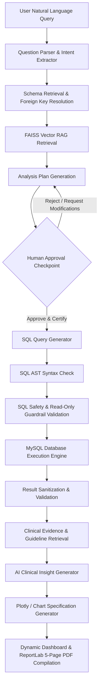
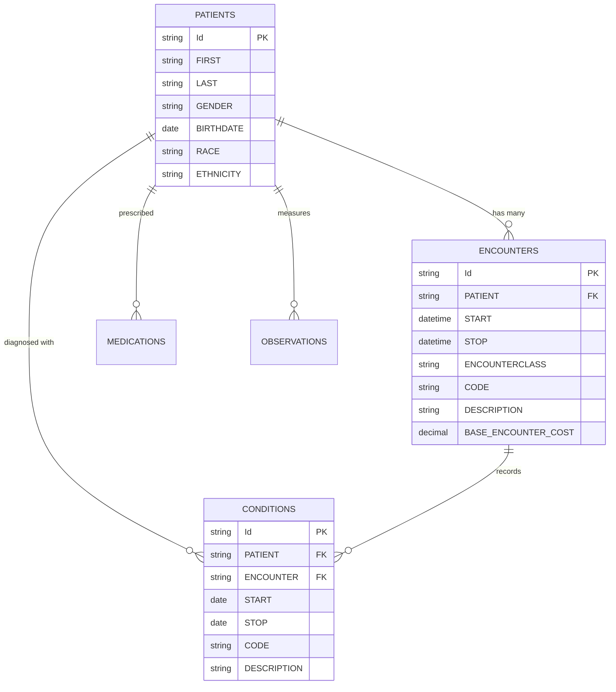

# 🏥 Clinical Analytics & AI Decision Support Platform
## Comprehensive End-to-End Technical Documentation & Implementation Guide

---

## 📑 Table of Contents
1. [Executive Overview](#1-executive-overview)
2. [System Architecture & Workflow Pipeline](#2-system-architecture--workflow-pipeline)
3. [Technology Stack & Frameworks](#3-technology-stack--frameworks)
4. [Complete Packages & Libraries Catalog](#4-complete-packages--libraries-catalog)
5. [Database Architecture & Clinical Data Model](#5-database-architecture--clinical-data-model)
6. [Core Modules & Component Breakdown](#6-core-modules--component-breakdown)
7. [Prerequisites & Environment Configuration](#7-prerequisites--environment-configuration)
8. [Step-by-Step Installation & Setup Guide](#8-step-by-step-installation--setup-guide)
9. [How to Run the Application](#9-how-to-run-the-application)
10. [API Reference & Endpoint Guide](#10-api-reference--endpoint-guide)
11. [Troubleshooting & FAQ](#11-troubleshooting--faq)

---

## 1. Executive Overview

The **Clinical Analytics Platform** is an enterprise-grade, dual-workspace AI analytics system designed for healthcare organizations, clinical researchers, hospital administrators, and data engineers.

### Core Value Proposition
- **Dual Workspace Experience**:
  - **Technical Workspace**: Offers data engineers and analysts full transparency into SQL queries, execution plans, AST safety validations, schema graphs, vector RAG contexts, and raw execution logs.
  - **Clinical Workspace**: Provides clinicians, department heads, and auditors with intuitive visual dashboards, KPI cards, clinical insights, follow-up Q&A, and publication-ready multi-page PDF audit reports.
- **Deterministic Analytics with AI Reasoning**: Natural language questions are translated into safe, read-only MySQL SQL queries against real electronic health records (EHR). The LLM does not hallucinate data; it reasons strictly over verified SQL aggregation outputs and retrieved clinical evidence.
- **Human-in-the-Loop (HITL) Governance**: Strict LangGraph human approval checkpoints ensure that queries and plans are inspected, refined, or certified before heavy execution or publication.
- **Enterprise PDF Certification**: Generates 5-page publication-grade A4 clinical audit reports using ReportLab with vector charts, audit timestamps, and regulatory compliance disclosures.

---

## 2. System Architecture & Workflow Pipeline

### End-to-End LangGraph Orchestration



### Execution Stages

1. **Question Parsed**: Extracts clinical metrics, cohorts, date ranges, and encounter classes from natural language queries.
2. **Schema Retrieval**: Automatically discovers relevant clinical tables (`encounters`, `conditions`, `patients`, `medications`, `observations`) and active foreign key relationships.
3. **RAG Retrieval**: Retrieves medical coding standards, clinical definitions, and hospital KPIs from FAISS vector storage.
4. **Analysis Plan Generation**: Produces a structured, multi-step analytical methodology.
5. **Human Approval Checkpoint**: Halts execution, presenting the plan, suggested tables, and methodology to human analysts for feedback or certification.
6. **SQL Generation & Validation**: Generates optimized MySQL syntax, verifies AST grammar, and enforces strict read-only safety rules (blocking `DROP`, `DELETE`, `UPDATE`, `INSERT`, `ALTER`).
7. **Execution & Validation**: Executes the query on MySQL, calculates execution time, formats result rows, and verifies data integrity.
8. **Evidence & Insight Generation**: Compares SQL findings against clinical benchmarks and produces physician-ready clinical insights.
9. **Visualization & Report Compilation**: Generates Plotly chart specifications and compiles an official 5-page ReportLab PDF document.

---

## 3. Technology Stack & Frameworks

### Backend Technologies
- **Python (v3.10+)**: Core server-side programming language.
- **FastAPI (v0.115.6)**: High-performance asynchronous web framework for building REST APIs with automatic OpenAPI (Swagger) documentation.
- **Uvicorn (v0.32.1)**: Production ASGI server for FastAPI.
- **SQLAlchemy (v2.0.36)**: Python SQL toolkit and Object-Relational Mapper (ORM) for MySQL connection pooling and query management.
- **PyMySQL (v1.1.1) & Cryptography (v44.0.0)**: Pure-Python MySQL database driver with secure authentication support (`caching_sha2_password`).
- **LangGraph & LangChain Core**: Stateful multi-actor agent orchestration engine with human-in-the-loop interruption support.
- **Ollama / Gemini**: LLM execution engines (local models: `tinyllama`, `llama3`, `mistral`, `qwen2.5`; cloud models: `gemini-3.1-flash-lite`, `gemini-3.8-flash`).
- **FAISS (`faiss-cpu` / `langchain-community`)**: High-speed in-memory and disk-persisted vector search index for RAG clinical guideline retrieval.
- **ReportLab (v4.0+)**: Enterprise PDF compilation engine with precision layout, page numbering, flowables, and tables.
- **Pandas (v2.2.3) & OpenPyXL (v3.1.5)**: High-performance tabular data manipulation, CSV ingestion, Excel reading, and schema profiling.
- **Pydantic (v2.7+) & Pydantic-Settings**: Data validation, schema enforcement, and type-safe environment configuration.

### Frontend Technologies
- **React (v18.3.1)**: Declarative UI component library.
- **TypeScript (v5.7.3)**: Statically typed JavaScript for maintainable, enterprise code.
- **Vite (v6.1.0)**: Fast build tool and development server with Hot Module Replacement (HMR) and reverse proxy configuration.
- **TailwindCSS (v3.4.17)**: Utility-first CSS framework for clean, modern clinical dark/light styling.
- **Lucide React (v0.475.0)**: Icon system.
- **PDF.js (`pdfjs-dist` v3.11.174)**: In-browser PDF rendering engine utilizing HTML5 canvas with page-by-page rendering and zoom scaling.
- **Plotly.js (`plotly.js-dist-min` & `react-plotly.js`)**: Interactive clinical charting engine for bar charts, distributions, scatter plots, and time-series.
- **Axios (v1.7.9)**: HTTP client with request timeouts and interceptors.

---

## 4. Complete Packages & Libraries Catalog

### Backend (`requirements.txt`)

| Package | Version | Purpose & Usage in Project |
| :--- | :--- | :--- |
| `fastapi` | `0.115.6` | Core web framework powering REST API routes, parameter validation, and exception handling. |
| `uvicorn[standard]` | `0.32.1` | ASGI server running the FastAPI application with live auto-reload. |
| `sqlalchemy` | `2.0.36` | Database abstraction layer, engine pooling, and SQL text execution. |
| `pymysql` | `1.1.1` | MySQL connector executing SQL queries against the local/remote MySQL server. |
| `cryptography` | `44.0.0` | Encryption library required by PyMySQL for modern MySQL 8.0 auth plugins. |
| `pydantic` | `2.7.0+` | Request and response schema serialization, typing, and validation. |
| `pydantic-settings`| `2.7.0` | Loads and validates `.env` environment variables into structured configuration classes. |
| `python-dotenv` | `1.0.1` | Reads `.env` files into environment variables. |
| `python-multipart` | `0.0.20` | Handles multipart form data for file uploads (CSV, XLSX ingestion). |
| `pandas` | `2.2.3` | Ingestion data reading, column type inference, summary statistics, and missing value detection. |
| `openpyxl` | `3.1.5` | Excel `.xlsx` workbook parsing engine used by Pandas. |
| `reportlab` | `>=4.0.0`| Programmatic compilation of multi-page A4 certified clinical PDF reports. |
| `matplotlib` | `>=3.8.0`| Chart figure generation embedded directly into PDF reports. |
| `faiss-cpu` | `*` | In-memory and disk-persisted vector search index for RAG clinical guideline retrieval. |
| `sentence-transformers`| `*` | Embedding generation for RAG semantic search. |
| `langgraph` | `*` | Directed acyclic graph (DAG) state machine orchestrating analytical steps and approval checkpoints. |
| `langchain-core` | `*` | Core prompts, chat model wrappers, and document schemas. |
| `requests` | `*` | HTTP requests to local Ollama LLM endpoints (`http://localhost:11434`). |

### Frontend (`frontend/package.json`)

| Package | Version | Purpose & Usage in Project |
| :--- | :--- | :--- |
| `react` | `^18.3.1` | Core UI component framework. |
| `react-dom` | `^18.3.1` | DOM renderer for React. |
| `typescript` | `^5.7.3` | Type system ensuring compile-time safety across components, props, and API payloads. |
| `vite` | `^6.1.0` | Development server, bundler, and proxy configuration. |
| `tailwindcss` | `^3.4.17` | Utility-first styling with responsive design and modern dark palette. |
| `lucide-react` | `^0.475.0`| Iconography (medical, status, navigation, control buttons). |
| `axios` | `^1.7.9` | HTTP client with custom timeouts and error handlers for API communication. |
| `pdfjs-dist` | `^3.11.174`| Mozilla PDF.js canvas rendering engine for interactive in-modal PDF previewing. |
| `react-plotly.js`| `^2.6.0` | React wrapper for Plotly charts in clinical dashboards. |
| `plotly.js-dist-min` | `^3.0.1` | Minified Plotly charting bundle. |
| `react-router-dom`| `^7.1.5` | Client-side routing between views. |

---

## 5. Database Architecture & Clinical Data Model

The platform runs on **MySQL 8.0+** and uses the `clinical_analytics` database with standardized EHR schemas.

### Primary Clinical Tables



### System & Governance Tables
- **`metadata_tables`**: Stores ingested table names, row counts, column counts, file hashes, and upload timestamps.
- **`metadata_columns`**: Column-level profiling, inferred SQL types, null percentages, min/max statistics, and unique counts.
- **`relationship_candidates`**: Candidate foreign key relationships discovered through column name heuristics, cardinality, and overlap metrics.
- **`approved_relationships`**: Human-approved relationship mappings utilized by the SQL generator to build deterministic `JOIN` clauses.

---

## 6. Core Modules & Component Breakdown

### Backend Structure (`/app`)

```
app/
├── ai/
│   ├── insight_generator.py      # LLM clinical insight generator
│   ├── insight_regenerator.py    # Follow-up query & insight refiner
│   ├── sql_generator.py          # Deterministic SQL synthesis from plan
│   └── sql_safety.py             # AST parser and safety guardrail engine
├── analytics/
│   ├── dashboard_service.py      # Dynamic KPI and aggregation calculator
│   ├── followup_service.py       # Conversational follow-up engine
│   └── query_executor.py         # Safe MySQL query execution & timing
├── api/
│   ├── analytics.py              # /analytics routes (run, dashboard, pdf, followup)
│   ├── database.py               # /database inspection & raw query tools
│   ├── health.py                 # /health status and DB connectivity check
│   ├── ingestion.py              # /ingestion upload, analysis, and validation
│   └── relationships.py          # /relationships candidate discovery & approval
├── core/
│   ├── database.py               # SQLAlchemy engine and session factory
│   └── logging_config.py         # Structured logging configuration
├── database/
│   └── session.py                # Database initialization and metadata tables
├── ingestion/
│   ├── file_reader.py            # CSV/XLSX streaming reader
│   ├── schema_inference.py       # Dynamic data profiler and type detector
│   └── validator.py              # Data hygiene and integrity checks
├── rag/
│   ├── chroma_service.py         # ChromaDB client initialization
│   ├── embeddings.py             # Vector embedding generation
│   └── documents/                # Medical definitions, guidelines, and metrics
├── reporting/
│   └── pdf_generator.py          # Enterprise 5-Page ReportLab PDF builder
├── schemas/
│   ├── analytics.py              # Pydantic models for analytics requests & responses
│   └── reports.py                # Pydantic models for PDF generation
└── workflow/
    ├── graph.py                  # LangGraph state machine definition
    ├── nodes.py                  # Pipeline execution nodes
    └── state.py                  # State schema and typed dictionary
```

### Frontend Structure (`/frontend/src`)

```
frontend/src/
├── api/
│   └── client.ts                 # Axios instance with base URL and interceptors
├── components/
│   ├── ClinicalDashboard.tsx     # KPI cards, charts, and clinical findings
│   ├── TechnicalWorkspace.tsx    # SQL editor, AST safety badges, and query plans
│   ├── ReportModal.tsx           # Certified PDF review and download modal
│   ├── PDFViewer.tsx             # Interactive PDF.js multi-page canvas viewer
│   ├── PDFPageCanvas.tsx         # Page-level canvas renderer with zoom scaling
│   ├── IngestionView.tsx         # Drag-and-drop CSV/XLSX upload interface
│   ├── RelationshipManager.tsx   # Relationship discovery and approval panel
│   └── WorkspaceToggle.tsx       # Switcher between Technical & Clinical workspaces
├── App.tsx                       # Main application state and workspace coordinator
├── index.css                     # Tailwind design system tokens and utilities
└── main.tsx                      # React root entry point
```

---

## 7. Prerequisites & Environment Configuration

### System Prerequisites
1. **Python**: Version `3.10` or higher.
2. **Node.js**: Version `18.0` or higher (with `npm`).
3. **MySQL Server**: Version `8.0` or higher running on `localhost:3306`.
4. **Ollama**: Installed and running locally (`ollama serve`).

### Environment Variables (`.env`)

Create a `.env` file in the project root directory:

```ini
# --- Application Configuration ---
APP_NAME="Clinical Analytics Platform"
APP_VERSION="1.0.0"
ENVIRONMENT="development"
DEBUG=True

# --- Server Host & Port ---
API_HOST="127.0.0.1"
API_PORT=8001

# --- MySQL Database Configuration ---
MYSQL_HOST="localhost"
MYSQL_PORT=3306
MYSQL_USER="root"
MYSQL_PASSWORD="your_mysql_password"
MYSQL_DATABASE="clinical_analytics"

# --- Ingestion & Uploads ---
UPLOAD_DIRECTORY="data/uploads"
MAX_UPLOAD_SIZE_MB=50

# --- LLM / Ollama Configuration ---
OLLAMA_BASE_URL="http://localhost:11434"
LLM_MODEL="tinyllama"
LLM_TIMEOUT_SECONDS=120

# --- Vector Database (ChromaDB) ---
CHROMA_PERSIST_DIRECTORY="data/chroma_db"
```

---

## 8. Step-by-Step Installation & Setup Guide

### Step 1: Database Setup
1. Log in to MySQL:
   ```sql
   CREATE DATABASE IF NOT EXISTS clinical_analytics CHARACTER SET utf8mb4 COLLATE utf8mb4_unicode_ci;
   ```

### Step 2: Backend Setup
1. Open PowerShell or a terminal in the project root:
   ```powershell
   # Create a virtual environment
   python -m venv .venv

   # Activate virtual environment
   # Windows PowerShell:
   .venv\Scripts\Activate.ps1

   # Install Python dependencies
   pip install -r requirements.txt
   ```

### Step 3: Ollama Model Setup
1. Start Ollama and download the preferred language model:
   ```powershell
   ollama pull tinyllama
   # Or for higher reasoning capability:
   ollama pull llama3
   ```

### Step 4: Frontend Setup
1. Navigate to the `frontend/` directory and install packages:
   ```powershell
   cd frontend
   npm install
   cd ..
   ```

---

## 9. How to Run the Application

### 1. Start the FastAPI Backend Server
From the project root (with `.venv` activated):
```powershell
python -m uvicorn app.main:app --reload --host 127.0.0.1 --port 8001
```
- **Backend API**: `http://127.0.0.1:8001`
- **Interactive Swagger Documentation**: `http://127.0.0.1:8001/docs`

### 2. Start the Vite Frontend Dev Server
In a second terminal window:
```powershell
cd frontend
npm run dev
```
- **Frontend Web Application**: `http://localhost:5173/`

---

## 10. API Reference & Endpoint Guide

| Method | Endpoint | Description |
| :--- | :--- | :--- |
| `GET` | `/health` | Server and database health check status. |
| `POST`| `/ingestion/upload` | Uploads CSV/XLSX file, infers schema, and profiles data. |
| `POST`| `/relationships/candidates`| Discovers potential foreign key relationships across tables. |
| `POST`| `/relationships/review` | Approves or rejects relationship candidates. |
| `POST`| `/analytics/run` | Executes the LangGraph analytical workflow up to approval or completion. |
| `POST`| `/analytics/dashboard` | Computes dynamic real-time KPI aggregations for selected tables. |
| `POST`| `/analytics/followup` | Answers conversational follow-up questions without pipeline resets. |
| `POST`| `/analytics/report/pdf` | Compiles and returns the certified 5-page publication-grade PDF report. |
| `GET` | `/analytics/report/pdf/Clinical_Analytics_Report.pdf` | Direct native browser attachment download of the latest PDF report. |

---

## 11. Troubleshooting & FAQ

### 1. PDF Download appears with an unexpected name or format
- **Cause**: Browser blob interception or cross-origin restrictions.
- **Solution**: The application uses the native Windows File System API (`showSaveFilePicker`) and direct server routes (`/analytics/report/pdf/Clinical_Analytics_Report.pdf`) with explicit `Content-Type: application/pdf` and `Content-Disposition: attachment` headers, guaranteeing `.pdf` file format on Windows and Chrome.

### 2. LLM / Ollama Request Timeout
- **Cause**: Running heavy models on CPU without GPU acceleration.
- **Solution**: Set `LLM_MODEL="tinyllama"` or `LLM_MODEL="qwen2.5:1.5b"` in `.env` for fast sub-second inference on standard laptops.

### 3. MySQL Connection Refused
- **Cause**: MySQL server service is stopped or port `3306` is unreachable.
- **Solution**: Ensure MySQL service is running via Windows Services (`services.msc`) and verify credentials in `.env`.

---

*Document compiled and verified for the Clinical Analytics Platform.*
